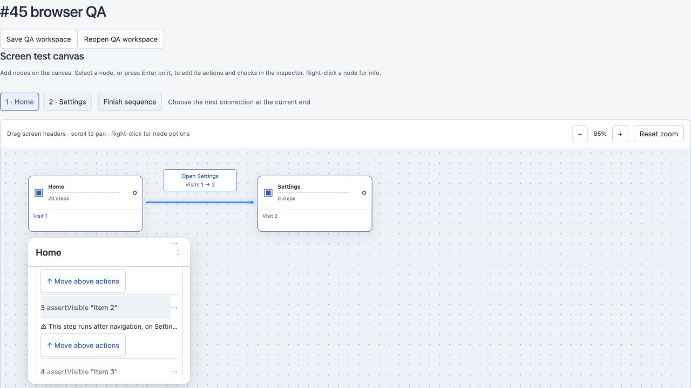

# Visit add-step authoring (#45)

Visits now append actions and checks to their explicit operation list. The canvas's legacy Add check path remains unchanged. New visit actions have no destination until the author chooses one. Only visible/absent checks are supported by the current canvas selector contract; swipe and scroll are omitted.

The inspector uses one summary button per step, a grouped searchable Add step dialog, and local inline drafts. Enter, Done or leaving a row saves; Escape or Cancel discards. An unchanged edit does not copy a shared operation. Destination cleanup uses the existing confirmation and preserves Undo. The navigation hint names the last preceding destination; Move above actions crosses the first navigating action in one graph change and announces its new position.

## Verification

- Typecheck clean; full suite: 282/282 passing before the additional fade regression, including save/reopen journeys and the golden UI comparisons.
- Focused regressions: 17/17 passing, including keyboard filtering/selection/Escape focus, Enter/blur/cancel, one Undo after Move above actions, and overflow-only fade.
- Named `add-check placement (intended change, #40)` test checks operationIds, derived execution order, and byte-identical workspace YAML versus the main append-to-storage path.
- Canvas contract check passes; server/, shared/ and default-actions are untouched.
- Golden update run: 18/18 passing with no fixture or snapshot changes; repeated to check drift.
- Browser QA on isolated port 43145, using the real CanvasEditor with a 20-step fixture: keyboard-only menu filtering with `ass`, ArrowDown/Enter adds assertNotVisible and focuses its empty selector; Enter saves, Escape cancels, blur saves and the serialized workspace reopens with the edited value. Menu Escape returns focus to + Add step.
- Long-list card: scrollHeight 2666, clientHeight 270, fade present. The no-overflow DOM regression requires the fade to disappear when clientHeight equals scrollHeight.

## Mutation evidence

Each mutation was applied alone, tested with `node --import tsx --test tests/inspector-operations.test.ts`, and restored immediately:

| Function | Mutation | Result |
| --- | --- | --- |
| appendVisitStep | Return the original graph | 4 tests fail, including intended #40 placement and limit checks |
| navigationHint | Always return undefined | 2 tests fail, including the two-action/same-screen hint cases |
| moveAboveNavigation | Return the original graph | Atomic move/unchanged YAML test fails |

The original helpers pass all four tests after restoration. Golden drivers now open summaries and press Done; an unchanged destination also asserts that no extra save occurred. Existing assertions remain strict, with removed Add action/Add check controls replaced by explicit menu choices and new actions' destinations chosen explicitly.
