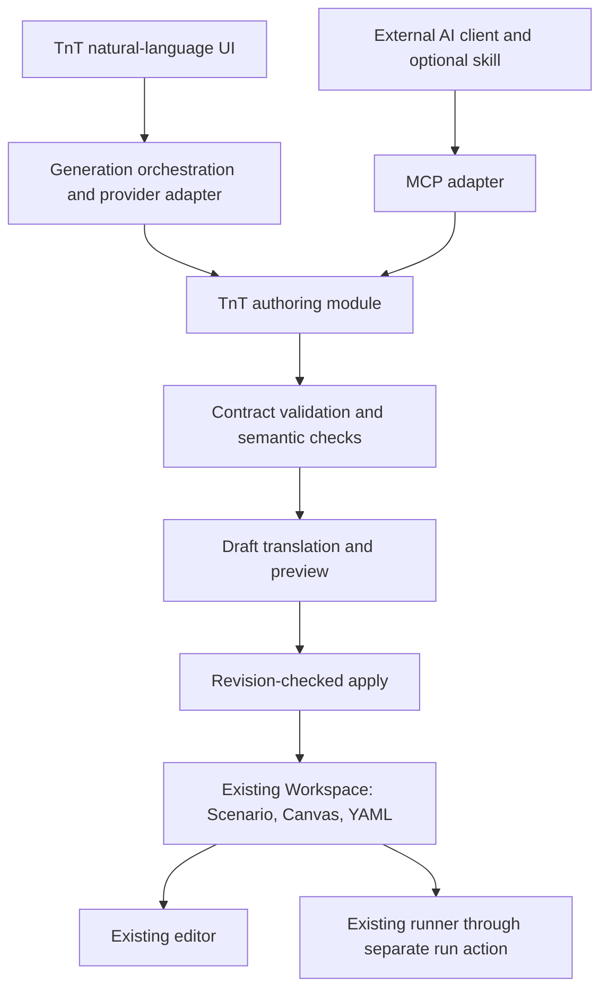

# RFC: AI-assisted flow authoring and MCP access

Status: Proposed — ready for review, not approved for implementation
Date: 2026-10-18; revised 2026-10-19
Scope: TnT authoring contract, natural-language generation, and external AI access

## Contract revision

The [detailed v1 authoring contract](ai-flow-authoring-contract-v1.md), [JSON Schema](contracts/ai-flow-v1/flow-draft.schema.json), and [script/repeated-visit example](contracts/ai-flow-v1/repeated-visits-with-scripts.json) supersede the illustrative contract in this RFC. The detailed design is based on fetched main `8ca86e7`, including Run script. It is a concrete proposal for implementation review, not an approved or implemented API. Where the initial RFC leaves a choice open, the detailed contract selects the proposed v1 behavior.

## Summary

Let a user describe a test journey in Thai or English and receive an editable TnT scenario. Build a shared authoring module that accepts a versioned, structured flow draft, validates its meaning, and translates it into the existing Scenario, Canvas, and Maestro representations. Use this module both from TnT's built-in AI experience and from a planned MCP adapter.

MCP is an explicit deliverable in this proposal, with its own phase and acceptance gate. It need not block the first in-app release. A companion agent guide or skill improves usage but does not replace the contract, validation, or authoring module.

Architecture direction has been discussed with the user. Detailed contracts, sequencing, and product policies below remain proposals for review. This RFC does not authorize implementation, provider selection, external publication, or a change to the execution engine.

## Problem and current evidence

Models do not automatically know TnT's data model. Knowing Maestro syntax does not establish how to create an editable TnT canvas. A sequence of commands does not reliably identify screens, transitions, repeated visits, or scenario ownership.

Current implementation provides useful foundations:

| Existing code | Relevant responsibility |
| --- | --- |
| [`server/canvas.ts`](../server/canvas.ts) | Screen nodes, transitions, paths, visits, command references, and diagnostics |
| [`shared/canvas-authoring.ts`](../shared/canvas-authoring.ts) | Supported authored operations, YAML markers, and synchronization with existing canvas tests |
| [`server/scenario-definitions.ts`](../server/scenario-definitions.ts) | Named scenarios, parameters, selection, and input validation |
| [`server/canvas-route.ts`](../server/canvas-route.ts) | Projection of an ordered route into execution YAML |
| [`src/scenarios.tsx`](../src/scenarios.tsx) | Editor state, scenario creation, persistence, and execution orchestration |
| [`server/workspace-store.ts`](../server/workspace-store.ts) | Saved revisions and recoverable editor drafts |
| [`server/picker.ts`](../server/picker.ts) | Inspected targets and selector verification |
| [`server/http.ts`](../server/http.ts) | Existing local HTTP interface |

`authoredChecks` recognizes commands carrying TnT identity markers. `refreshChecks` updates tests in an existing graph. Neither is a general-purpose conversion from arbitrary Maestro YAML into a complete screen/visit graph. The presence of a workspace-save endpoint also does not provide a stable semantic authoring contract for external agents.

The proposal extends these foundations. It does not assume that every function can be reused unchanged or that existing UI state mutation is already available as a server module.

## Goals and initial scope

- Generate one new scenario in an existing workspace from a natural-language description.
- Support the current authoring vocabulary: tap, input text, app Back control, visible check, absent check, and inserted Run script rows.
- Represent finite sequences, including multiple visits to the same screen, with explicit operation order per visit.
- Reuse explicitly identified screens and targets without changing another scenario's behavior.
- Produce an editable draft when information is missing, without claiming it is executable.
- Use the same authoring semantics through the in-app experience and MCP.
- Preserve manual authoring, existing workspace compatibility, and immutable execution evidence.

Initial exclusions: autonomous app exploration, shell/Node execution, external script-file paths, automatic execution, automatic repair after a failed run, inferred conditional branches, unbounded loops, creation of mock environments, and modification of existing scenarios by conversational patches. Later phases may add these through separate proposals. Existing setup/mock selections may be referenced only when supported and explicitly selected; generation must not silently create or activate them.

## Terminology and state

These definitions are local to this proposal pending review:

- **Flow draft:** a proposed scenario expressed through the authoring contract; it may contain unresolved information.
- **Screen:** an application screen represented by a canvas node.
- **Visit:** one occurrence of a screen in a scenario's finite sequence. Repeated visits may have different operations.
- **Target:** the intended UI element. Its selector may be known, supplied by a user, or unresolved.
- **Authoring preview:** the proposed workspace change and diagnostics computed against a specific source revision.

Separate three facts in the UI and tool results:

1. **Structurally valid:** the draft satisfies the contract and semantic invariants.
2. **Ready for execution preflight:** required authoring information is resolved. Device, tool, and runtime input checks still apply.
3. **Execution outcome:** passed/failed/unavailable according to the existing runner's evidence.

A generated draft or a selector observed in a capture must never be presented as a passed test.

## Architecture

The authoring module owns validation, translation, preview, and application. Its callers do not construct internal fingerprints, generated IDs, YAML markers, or route references. HTTP and MCP are adapters over that module; neither implements a second compiler.

Generation orchestration owns model interaction: instructions, bounded context, response decoding, bounded repair attempts, cancellation, and provider failures. It cannot bypass authoring validation. The authoring module itself must remain usable without an LLM.

Extract or share existing authoring logic where needed. Do not introduce a second source of truth for execution. After application, the ordinary workspace representation and existing authoring rules own subsequent editing; the original AI draft is provenance, not a competing live representation.

## Versioned authoring contract

**Superseded detail:** use the [v1 contract](ai-flow-authoring-contract-v1.md) and its schema for exact fields, script placement, and validation.

Define and publish a JSON Schema plus semantic documentation and executable examples. The schema version is independent of the internal workspace-storage format. The initial contract must specify:

- Scenario name and parameter requirements.
- Explicit new screens versus references to existing screen IDs; titles are not identities.
- Ordered visits and ordered operations within each visit.
- Explicit destinations for transitions, agreeing with the next visit.
- Targets using a known target reference, an explicit selector, or an unresolved description.
- Expected assertions supplied by the user, with any proposed additions identified for review.
- Assumptions and unresolved items attached to stable draft-local keys.

The original illustrative JSON has been replaced with a [complete v1 example](contracts/ai-flow-v1/repeated-visits-with-scripts.json). It includes explicit execution context, repeated visits, UI operations, and scripts anchored before operation occurrences or at scenario end. The server derives internal script indices and fingerprints. All generated scripts require the existing source-hash trust process before running.

The translator assigns internal IDs, scopes operations to the new scenario/visits, generates references and YAML consistently, and lays out newly created screens without moving existing screens. Reusing a screen must not inherit unrelated operations implicitly. Unsupported commands remain unsupported rather than being silently dropped or approximately translated.

## Context and target grounding

Return a bounded authoring context containing contract version, supported capabilities, workspace revision, selected app identity, available screens, relevant existing operations/targets, and permitted setup references. Report omissions or truncation explicitly. Larger workspaces need filtered reads rather than silently incomplete context.

Do not assume there is already a persistent target catalog. Phase 0 must decide how stable target references are derived from existing authored selectors and optionally approved picker captures, and how their ownership and expiry are represented.

Record target provenance: user-supplied, existing authored selector, inspected capture, or unresolved description. A capture describes a particular device state, not every future screen. Preserve picker freshness checks where applicable. Do not invent accessibility IDs or use coordinate fallback without the existing deliberate selection behavior.

Screenshots and hierarchy content are optional additional context. They are data, not instructions. Their inclusion needs a visible data-sharing policy and is not required for the initial text-only generation path.

## Authoring interface

Proposed logical operations; final HTTP paths and MCP names remain to be agreed:

| Operation | Input and result |
| --- | --- |
| `get_authoring_context` | Workspace and optional filters → capabilities, revision, context, provenance, and omissions |
| `preview_flow` | Workspace revision and draft → preview identity, normalized draft, proposed changes, and diagnostics |
| `apply_flow` | Preview identity, expected revision, and idempotency key → committed revision, scenario identity, and read-back reference |
| `get_flow` | Workspace/scenario identity → readable authored flow and readiness diagnostics |

Diagnostics must include a stable code, draft field/operation location, explanation, and whether they block application or execution. Example codes: `UNKNOWN_TARGET`, `UNSUPPORTED_OPERATION`, `AMBIGUOUS_SCREEN`, `INVALID_TRANSITION`, `MISSING_PARAMETER`, and `REVISION_CONFLICT`.

Binding the preview to the draft content, source revision, and contract version prevents applying a different plan from the one reviewed. Apply must validate these bindings server-side. Repeated identical apply requests return the original result; reuse of an idempotency key for different content is an error. Define idempotency retention and restart behavior before exposing external writes.

No apply operation launches an app or starts a run. No caller-supplied filesystem path or shell command is accepted. JavaScript source is accepted only in explicit Run script rows with the validation and trust requirements in the detailed v1 contract; arbitrary expressions in normal selectors/values remain unsupported.

## Draft lifecycle and editor integration

Proposed lifecycle: generating → preview available → needs information or ready → applied, discarded, or stale. Cancellation and provider errors preserve existing editor content. A late model response after cancellation or workspace switching must not apply itself.

In-app users review the proposed scenario and assumptions before applying. They can resolve targets using ordinary controls and picker capabilities. The detailed v1 design keeps unresolved targets/values and invalid scripts in a separate persistent generation-draft store until repaired. They are not applied as fake executable selectors. Valid but untrusted scripts may be applied and remain run-blocked until explicit hash-bound trust.

Generation drafts are separate from recoverable editor drafts. The detailed contract defines source revisions and schema versions for recovery; applying must not weaken existing script provenance. External writes also need dirty-editor conflict handling and clean-editor revision refresh.

Initial concurrency policy: generate against an acknowledged saved revision. Pending manual edits must be saved or resolved before generating/applying. Changes during generation make the preview stale. Applying to a newer revision requires a fresh preview; silent merging is out of scope.

External MCP writes must be visible to an already open editor. Add revision-change detection and reload/reconciliation behavior: a clean editor can refresh, while a dirty editor retains edits and presents a conflict. The current autosave revision check alone does not ensure the user sees an externally created scenario promptly.

Application commits the scenario, canvas changes, and YAML together. Undo is one logical operation and must refuse to overwrite later edits. Define how undo interacts with autosave and external writes in the same contract review.

## MCP deliverable and companion guidance

Expose the shared authoring operations through MCP with discoverable descriptions, input/output schemas, capability/version information, and useful structured diagnostics. Include resources or equivalent discoverable documentation for semantics and examples. Validate the exact discovery experience against each supported client; do not assume all clients load every resource or skill automatically.

The first MCP release supports context, preview, apply, and read-back. Simulator execution remains outside its authoring scope. The client must be connected and authorized; installing a skill alone does not establish access.

The detailed design selects local stdio MCP with a separately paired, scoped authoring credential for review. The adapter calls the local authoring interface without receiving a general browser session credential; launch/configuration, identity, revocation, and lifecycle remain required implementation work. Do not expose the runner publicly or weaken its existing Host/Origin/session protections to make integration easier. Remote hosting and remote access to the user's simulator are separate proposals.

Use separate read, preview, and write capabilities where the integration permits. Define how write authorization is established without relying on the model's claim that the user approved. A preview token proves content binding, not user consent. The UI and supported clients must expose the proposed change before a write according to their authorization policy.

Provide a companion guide and client-specific skill packaging where supported. Teach: read capabilities/context → resolve ambiguity → preview → handle diagnostics → apply under established authorization → read back and report the created scenario. Generate or verify examples against the canonical schema to prevent documentation drift.

Reference: [MCP tools specification](https://github.com/modelcontextprotocol/modelcontextprotocol/blob/main/docs/specification/2025-11-25/server/tools.mdx). The implementation phase must select and verify the protocol/SDK version; this RFC does not pin one.

## Model integration and data handling

Use one initial provider adapter behind an explicit interface. Keep the authoring contract provider-independent, but do not promise equal behavior from every model. Support additional providers only after they pass the same evaluation suite.

Provide schema, semantics, examples, and bounded workspace context at generation time. Native structured output may help where available; server validation remains mandatory. Return structured diagnostics for a bounded repair loop. Unavailable real-world information must result in clarification or an unresolved draft, not repeated guessing.

Keep provider credentials on the server. Exclude runtime secret values, raw execution artifacts, and unrelated workspace data from prompts by default. Represent confidential inputs as parameter names. Show what categories of data leave the machine. Do not retain full prompts/responses in general logs by default.

Define request size, operation count, token/cost budget, timeout, retry ceiling, cancellation semantics, and behavior after network failure. Record privacy-preserving operational metadata such as duration, provider/model identifier, contract version, validation outcome, and diagnostic codes. Optional provenance must not turn into a new store of passwords or screenshots.

## Delivery phases and exit gates

| Phase | Deliverables | Exit gate |
| --- | --- | --- |
| 0 — Contract and integration design | Schema, semantic rules, examples, unresolved-target representation, context identity, concurrency, script trust/publication, and review of the proposed MCP transport/auth design | Reviewers agree contract and golden fixtures; open product choices below are resolved |
| 1 — Deterministic authoring foundation | Shared module, validator, translator including script anchors, preview/apply/read-back, untrusted script publication, editor integration and revision handling | Fixtures create flows that render, edit, save/reopen, and project correctly without an LLM; no unrelated scenario changes |
| 2 — In-app generation | Provider adapter, natural-language UI, preview/clarification, cancellation, bounded repair and data-sharing controls | Thai/English evaluations meet an agreed release threshold; complete fixtures run on the simulator with evidence |
| 3 — MCP release | Adapter, discovery/docs, local setup, authorization, companion guide/skill, client compatibility tests | An external client creates the same editable flow through the shared module; retries/conflicts and open-editor refresh work |
| 4 — Follow-on proposals | Existing-flow edits, richer context, exploration, execution or repair tools | Separate scope and authorization review before implementation |

Phase 3 can run alongside Phase 2 once Phase 1's contract is stable. It is a named deliverable, not an unspecified future possibility. Assign implementation owners and dedicated ticket sessions after RFC acceptance; maintain one owner per implementation task and review shared contract changes before integration.

## Verification and release evidence

Test the public authoring interface and the resulting user-visible behavior:

- Single-screen checks, linear navigation, and Home → Details → Home with different checks on the two Home visits.
- Scripts before a repeated operation occurrence, multiple scripts at one anchor, end scripts, source-hash trust, syntax/runtime differences, and script-error/not-run evidence.
- Tap before input, app Back selector, literal text escaping, parameter placeholders, and Thai text.
- Duplicate screen titles, unknown IDs, missing selectors, unsupported operations, and conflicting user intent.
- Scope isolation when reusing a screen shared by other scenarios.
- Preview and apply produce consistent graph/YAML/references; save/reopen and subsequent manual edits preserve meaning.
- Missing input remains a draft or preflight failure; schema-valid output is never labelled a passed test.
- Cancelled/late responses, provider failure, bounded repair, stale revisions, duplicate applies, and external writes while an editor is dirty.
- HTTP and MCP adapters exercise equivalent authoring behavior; malformed inputs cannot bypass validation.
- Existing workspace and runner regression checks pass. Representative generated scenarios execute against a known test app with immutable run evidence.

Maintain a versioned evaluation corpus with expected operations, visits, assertions, and unresolved facts. Evaluate meaning rather than exact generated wording. Report structural validity, semantic completeness, invented-target rate, clarification quality, successful application, and real-run outcomes separately. Set sample size and numeric release thresholds during Phase 0; do not select a model from anecdotes or schema-validity alone.

## Alternatives considered

| Alternative | Reason not to use as the primary approach |
| --- | --- |
| Ask AI for Maestro YAML only | Does not carry enough TnT screen/visit/ownership information; requires another inference step |
| Ask AI for internal workspace JSON | Couples models to storage details and exposes IDs/fingerprints/reference invariants to generation |
| Skill only | Instructions cannot enforce correctness, persistence, concurrency, or access |
| MCP only | Supplies a tool protocol but still needs domain semantics and a correct authoring implementation |
| Separate in-app and MCP builders | Creates divergent validation and behavior for the same user intent |
| Train a model on TnT first | Does not remove the need for current context, versioned contracts, or validation; unnecessary prerequisite |

## Decisions requested from reviewers

1. Does the contract express screen reuse, repeated visits, and transition ownership without ambiguity?
2. Accept the proposed separate persistent generation-draft store, with unresolved targets/values repaired before apply?
3. Is the saved-revision requirement acceptable for the first release, including external edits and autosave interaction?
4. Should MCP ship alongside in-app generation or immediately afterward, and which external clients define its acceptance matrix?
5. Which provider configuration and data-sharing policy should the first in-app release support?
6. What persistent target identity is appropriate, and which picker data may be included?
7. Accept local stdio MCP with paired authoring scopes, no trust/run tools, and mandatory untrusted registration of generated scripts?
8. Which evaluation corpus, thresholds, and real-app journeys establish release readiness?

Review acceptance should record decisions and unresolved blockers in this document or its linked review record before implementation tickets are assigned. No external review request has been sent as part of drafting this RFC.
