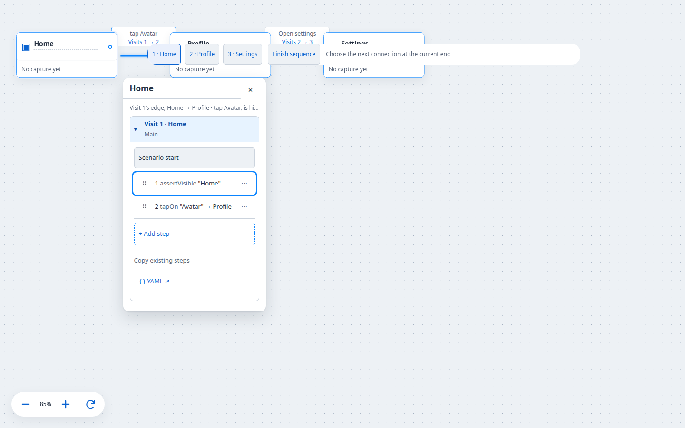
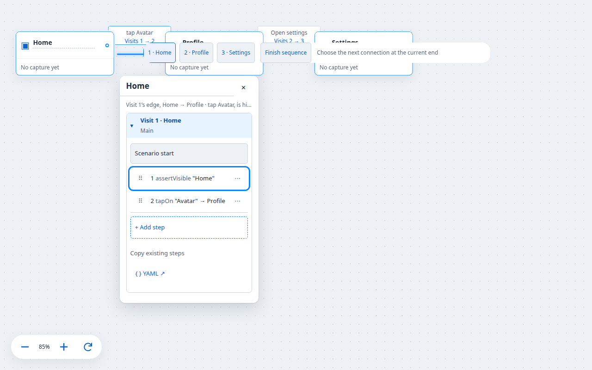
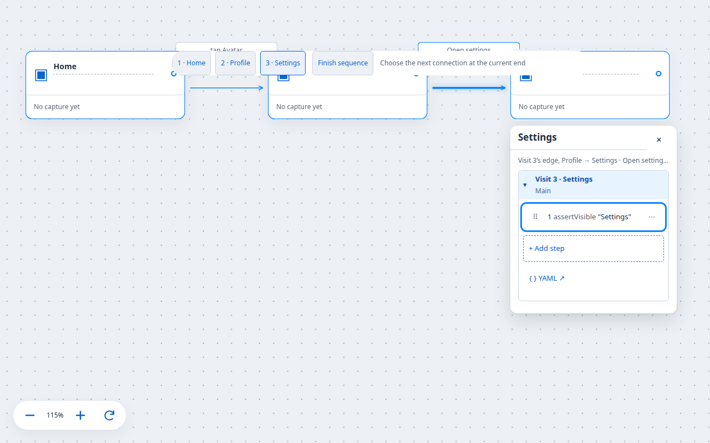
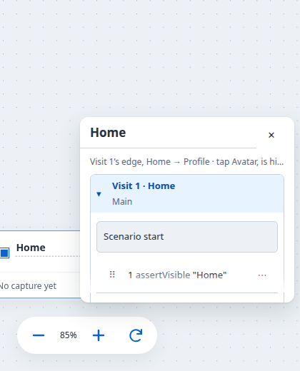
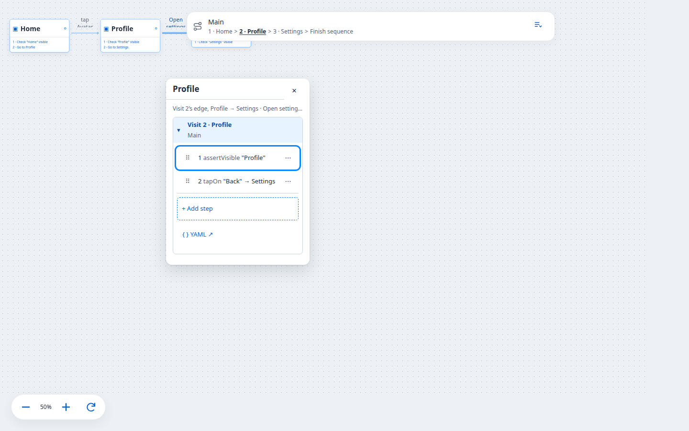
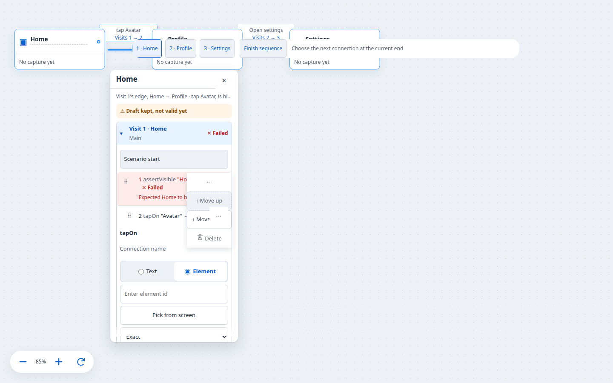
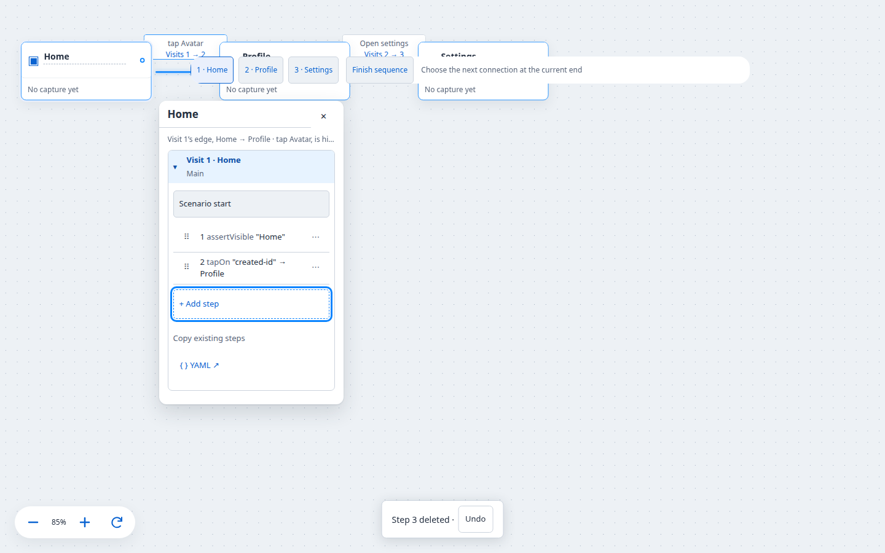

# Inspector keyboard, accessibility and desktop browser review (#51)

Parent: [#40](https://github.com/GE-N/TnT/issues/40) Option 1 floating inspector. Hardening pass across #43–#50.

## What changed

- **Tab order:** visit step summaries form one composite list (a single `tabIndex={0}` stop; Arrow Up/Down/Home/End move between rows). The one-stop / arrow contract stays active while a run is locked (edits stay blocked). Drag handles and the ⋯ trigger stay out of the tab order (`tabIndex={-1}`; ArrowRight reaches ⋯ when unlocked). Deleting or discarding the focused row heals the list stop onto a surviving row.
- **Inline edit order:** fields → Destination → Pick from screen (Element mode) → YAML → ✕. Pick stays in the Element edit flow visually (flex `order` under the selector) while DOM order keeps Destination before Pick for Tab.
- **Focus stability:** run / save / autosave still do not move focus (covered by #50 journeys and kept here). Esc closes the inspector only when the target is not an editable field; inline edit Esc still cancels the row first.
- **Shortcut suppression:** shared `isEditableTarget` suppresses single-key inspector/canvas shortcuts inside inputs, textareas, selects, comboboxes and the YAML editor (floating-card Esc/arrows, screen-node nudge arrows, step-list arrows).
- **Accessible structure:** errors keep `role="alert"`; run/status badges and notices keep `role="status"`. Targets remain ≥44px. Danger palette aligned to AA tokens `#b3261e` on `#fdecea`; warning `#8a4b00` on `#fff4e5`; primary `#0a63d1`.

UI-only: no `shared/`, `server/canvas*.ts` or `server/default-actions.ts` changes. Golden fixtures unchanged.

## jsdom coverage (public workspace boundary)

`tests/inspector-a11y-ui.test.ts` drives the real `Scenarios` + `createScenarios` persistence service (same journey pattern as #50), not an in-memory `CanvasEditor` host:

- one tab stop + Arrow/Home/End; deleting the last focused row keeps a stop
- discarding a new active row restores a surviving stop
- running keeps one list stop and arrow navigation without unlocking edits
- edit tab order fields → Destination → Pick → YAML → ✕ (DOM order)
- shortcut suppression in a focused selector; failed run announces `role="status"` / `role="alert"`

Existing floating-inspector, match-by and run-state UI journeys remain green.

## Desktop browser review

Reviewed with the real `CanvasEditor` fixture via Vite + Chrome headless (`scripts/inspector-browser-review.mjs`) on Linux, Node 22. Metrics: `docs/evidence/inspector-a11y-metrics.json`.

Desktop shots open the named screen with Enter on its article, then Tab to the step summary. The keyboard journey does not call `focus()` or click controls from script.

| Shot | Viewport | Recorded |
| --- | --- | --- |
| 1440×900 Home | 1440×900, zoom 0.85 | Side **right**, left 259, top 164, inspector width **300**, not clamped. Focused `Edit Check 1`. Outline `rgb(10, 132, 255) solid 3px`. One list stop. |
| 1280×800 Home | 1280×800, zoom 0.85 | Same placement and focus ring. One list stop. |
| Settings flip | 1280×800, zoom 1.15 | Side **below**, left 920, top 227, width 300, **not clamped**. Same focus ring. |
| Profile zoom | 1440×900, zoom 0.5 | Side right, left 347, width **300**. Same focus ring. |
| Contrast and targets | 1440×900 Home, editing, failed check, draft notice | Rendered contrast below. Focus is not on a summary (`focused: body`), so this shot is not a focus-ring shot. |
| Clamp | 420×520, Home parked far right/bottom (`clamp=1`) | **`clamped: true`**, side right, left 112, top 164, width 300, viewport 420×520. Focus was not moved; outline is empty. |
| Keyboard journey | 1440×900 Home | Trace below. The screenshot is the end state after delete. |

### Rendered contrast

Samples are computed style of elements that are actually in the inspector. Shots that do not show a failed step or draft notice only record primary (Add step: `#0a63d1` on `#ffffff`, ratio 5.65). The contrast shot also records:

| Role | Paint | Ratio |
| --- | --- | --- |
| Danger (failed step) | `#b3261e` on `#fdecea` | 5.72 |
| Warning (draft notice) | `#8a4b00` on `#fff4e5` | 6.26 |

Token names are recorded separately and are not treated as the contrast result.

### Targets at least 44px

Contrast shot, with the step menu open: close 44×44, summary 254×47, Add step 254×48, Destination 254×44, Pick from screen 254×44, Done 254×44, Open YAML 86×44, Match by 124×44, Delete 104×44.

On shots that are not editing, Destination, Pick, Done and Match by are absent (recorded as null). Delete inside a closed ⋯ menu still has a box in this Chrome (44×57). The open-menu size is the one that counts.

### Keyboard-only journey

Recorded under `keyboard` in the metrics:

1. Enter on Screen Home, Tab to the list. One stop. ArrowDown, ArrowUp and End moved Check 1 ↔ Action 1.
2. Tab to Add step, Enter, Enter to create a Tap. Shift+Tab, ArrowRight to Element, type `created-id`.
3. Tab order from the selector: matching → type → **destination → Pick from screen**. Pick's box stays with the element field (top 294, directly under the selector at 244) and above Destination (top 462).
4. Shift+Tab back to Destination. ArrowDown twice changed the focused select from empty to `profile`. Enter on Done committed the step.
5. ArrowRight, Enter, Tab to Move up, Enter. Order changed from `home-ready, avatar, <new>` to `home-ready, <new>, avatar`.
6. End, ArrowRight, Enter, Delete on the last row (`Delete action 2`). Two rows remained and exactly one summary had `tabIndex=0`.

### Screenshots

## Keyboard-only walkthrough (recorded)

The trace above is the walkthrough. It creates a step, links Destination to Profile from the keyboard, reorders with Move up, and deletes the last focused row while leaving one list tab stop. Pick stays visually with the element field and comes after Destination in the tab order.

## Verification

- `npm run typecheck`
- `npm run build`
- `npm test` (2 known macOS-only `plutil` failures in `tests/apps.test.ts` on Linux)
- Golden #41 unchanged
- `npm run check:canvas-contract` empty

Re-run screenshots: `npm install --no-save puppeteer-core && node scripts/inspector-browser-review.mjs`.
