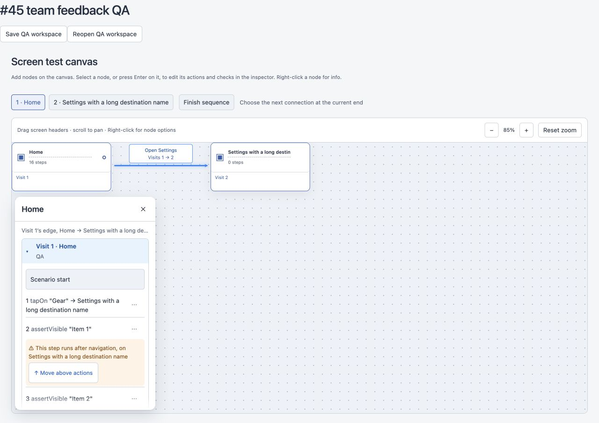
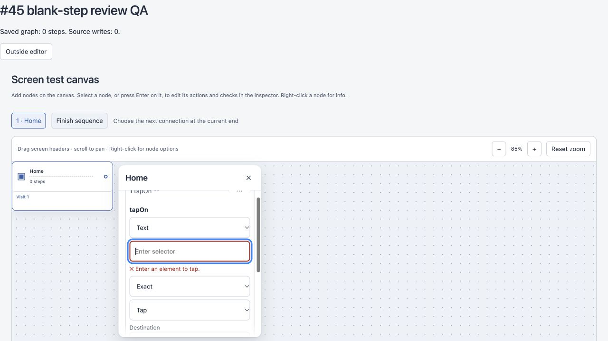

# Issue #45 team review follow-up

Follow-up to merged PR #63, based on Atlas, Shaka and Edison’s review in issue #45. The follow-up PR requires designated external team approval of its final revision, and Jerapong’s merge authorization. Local checks and subagent reviews cannot satisfy those gates.

## Behavior and review mapping

- Atlas: deleting steps and clearing destinations now apply immediately with one Undo; screen/connection deletion confirmation stays intact. Summary, overflow trigger/items, Move above actions and YAML controls are at least 44px high; the overflow trigger is 44px wide. YAML declares 12px; the shared inspector button rule computes it to 13px. Both meet the ≥12px requirement. The navigation warning occurs only on the first affected step, wraps long destinations, and uses #8a4b00 on #fff4e5.
- Shaka: pure `stepRowLabel()` covers every supported command, quotes and optional destination. Mouse Cancel saves nothing. Last Move down is disabled; destination lookup is scoped to the source screen. Restored graph/source refresh an open draft, preventing stale blur saves. Screen-only legacy selector edits are documented.
- Edison and agreed selector spec: `isCommittableSelector()` rejects empty/whitespace values while preserving meaningful surrounding spaces exactly. Enter and blur show the specified accessible error and retain an invalid draft without refocusing. Typing clears the error. Escape restores an existing value or removes a new blank selector without replacing prior Undo history. ArrowUp moves backward and wraps; Enter/Done return focus to the summary.
- A newly added Back step becomes saved on its first valid Done/Enter; cancelling a later blank edit preserves it.

The selected visit’s neutral border and shortened top note remain from the original #45 handoff. Optional anchored Add step placement remains outside this focused follow-up. Shaka signed off the original golden driver’s unchanged-save assertion from #63. The cleanup driver now asserts that no dialog appears.

## Initial follow-up validation (before the autosave blocker fix)

- Final full suite: 294/294 passing. Build/typecheck and canvas contract check pass. Build reports the existing bundle-size advisory (512 kB main bundle); no build failure. No server/shared/default-actions implementation changes; no golden fixture or snapshot drift.
- Two `GOLDEN_UPDATE=1 node --import tsx --test tests/golden-canvas.test.ts` runs: 18/18 each, committed snapshots unchanged.
- Focused floating inspector regressions: 22/22 passing. Pure helper tests cover every command with/without a destination and whitespace selector policy.
- Browser QA used the real CanvasEditor in an isolated local fixture, including the desktop viewport and long-list overflow. Verified blank Enter validation, 2px #b3261e field border, mouse Cancel/reopen, ArrowUp wrapping, new blank Escape, exact `" a "` save/reopen, immediate deletion/clear without a dialog, and single Undo restoration. QA serialization is a fixture harness; real workspace persistence is exercised by the existing UI journey suite.
- Computed hit targets: summaries ≥44px, overflow trigger 44×44px, overflow menu items 44px, Move above actions 44px, YAML 44px. Error text 12px. Contrast ratios: muted #596579 against white 5.90:1 and selected #e7f3ff 5.24:1; warning pair 6.26:1; error #b3261e against white 6.54:1.

## Mutation evidence

For the initial follow-up revision, each isolated mutation was applied to its source, run against its named regression, and immediately restored. All 13 were rejected by assertion failures:

| Mutation | Detecting test |
| --- | --- |
| Remove label quotes | stepRowLabel formats every command |
| Remove destination suffix | stepRowLabel formats every command |
| Skip whitespace trim | selector validation rejects empty whitespace |
| ArrowUp moves forward | ArrowUp moves backwards and wraps |
| Remove mouse Cancel pointer guard | mouse Cancel and Escape followed by focusout |
| Remove Escape cancelled guard | mouse Cancel and Escape followed by focusout |
| Remove draft reset on reopen | mouse Cancel and Escape followed by focusout |
| Remove save summary focus | mouse Cancel and Escape followed by focusout |
| Remove invalid-selector save guard | empty selector Enter and blur |
| Remove blur save | inline rows commit Enter and blur |
| Skip new blank discard | Escape discards a new blank selector |
| Skip revision-triggered draft reset | an external Undo refreshes an open draft |
| Keep new-step marker after unchanged Back save | a saved new Back step remains saved |

The production source was restored before final validation. The initial red run exposed the missing selector guard and label behavior before implementation. Existing cleanup tests continue asserting exact graph/source Undo restoration; their confirmation expectations now reflect the agreed immediate behavior.

## Selected visit header correction

The user identified a white strip beside the blue visit heading in the initial follow-up screenshot. The heading used 100% width with negative 8px side margins inside a section padded by 8px; the width did not include the removed padding. Its selected width now includes both sides with `calc(100% + 16px)`.

Browser verification at the desktop QA size and default viewport measured header left/right at 47/317px and section left/right at 46/318px: exactly the section’s 1px border on both sides. Focused inspector tests remain 22/22 passing and the production build/typecheck passes (same bundle-size advisory). This visual revision must be reviewed again before merge.

## Blank-step autosave blocker and rebase

Rebased onto main `70b75a3`, including #62 (`dd7c8c2`) and #59. The overlapping canvas/golden test changes from #62 remain intact. This PR now has no `AGENTS.md`, `server/`, `shared/`, `scripts/` or snapshot diff against its base. Atlas confirmed the app-wide warning tokens, so those remain.

Add creates a local inspector draft, validates limits and opens its inline row. It does not publish graph or YAML. Blank blur keeps the row/error visible; opening ⋯, scrolling and autosave cannot persist that step. Save/Run/workspace switching treat it as incomplete without serializing the step. Escape/Cancel remove the local draft without replacing Undo. Reordering and another Add wait until that draft is committed or cancelled. The first valid commit appends the step and optional destination atomically, preserves the exact selector, and creates one Undo entry. One Undo restores the previous graph and source.

Validation of the rebased blocker fix:

- Actual Scenarios/runner-store regression captures POST payloads for `/api/workspaces/:id/draft` (the existing-workspace counterpart of `/api/workspaces/draft`), advances mock timers past 800ms after blur/menu/scroll, and asserts that neither the new id nor an empty Tap appears in saved graph and that saved YAML is unchanged. An unrelated pending field ensures actual draft POSTs occur. After typing `" a "`, the next payload contains that step once with exact spaces; one Undo restores the previous graph/source.
- The original production behavior fails this test with an empty step in the draft payload. Mutations removing first-commit Undo or duplicating its graph write also fail their named assertions. The deliberate premature-publish mutant has its preview adjusted to avoid duplicate rendering; it fails the saved-payload assertion. All nine visual mutations (summary target, overflow width/item target, error font/colour/border, YAML font, warning colour and selected-heading width) fail the new style regression. Production source was restored, then focused tests pass 30/30 and the actual-payload regression passes.
- Focused inspector/helper tests: 30/30. Includes atomic first commit with a destination and CSS assertions for 44px controls, 12px error/YAML rules, error/warning colours, 2px error border and full-width selected heading.
- Full suite: 309/311. Both failures are in the newly merged `check-canvas-contract.test.ts`: clean pass with no exception patches, and quoted paths with no exception patches. Untouched main reproduces the same two failures under system Bash 3.2 (`exception_patches[@]: unbound variable`). No modern Homebrew Bash is installed. They are outside #45; the normal repository contract check passes with its recorded exception patch. No other tests fail.
- Build/typecheck pass with the existing bundle-size advisory. Two rebased GOLDEN_UPDATE runs pass 19/19 each; no fixture/snapshot drift.
- Browser QA: blank blur/menu leaves saved graph at zero steps and source writes at zero while keeping the error visible. Valid blur saves one step/one source write with exact spaces, keeps focus on the outside control, and one Undo restores zero steps. Escape on another blank draft returns focus to Add without any additional source write.

Final external Shaka/Edison review remains required. Jerapong has conditionally authorized merging after that review passes; tests and local review alone do not satisfy the gate.
