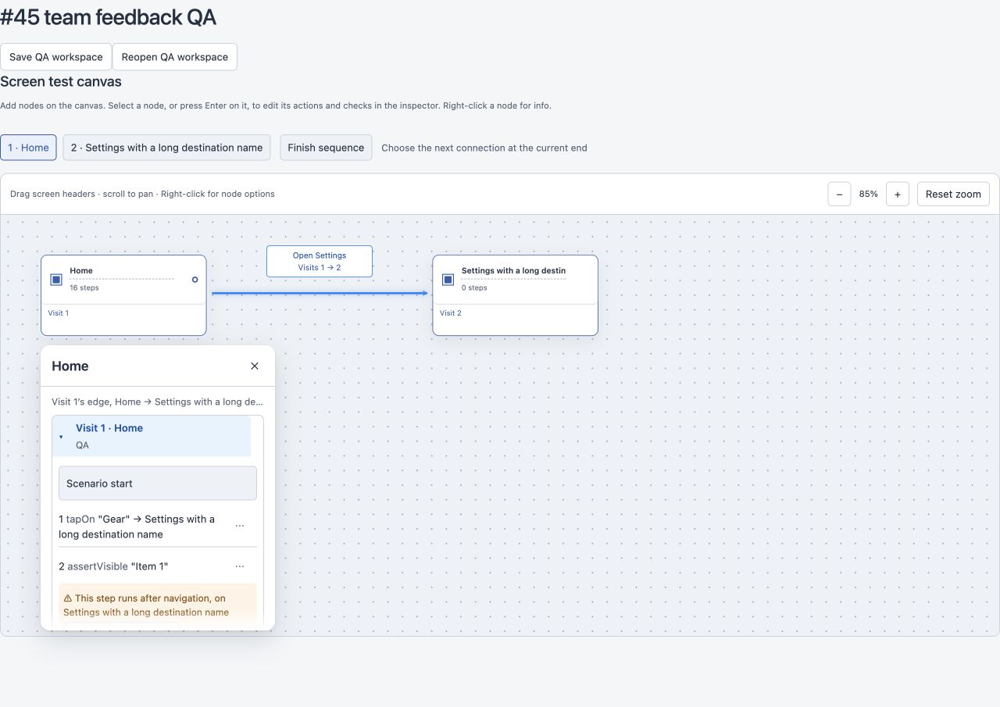
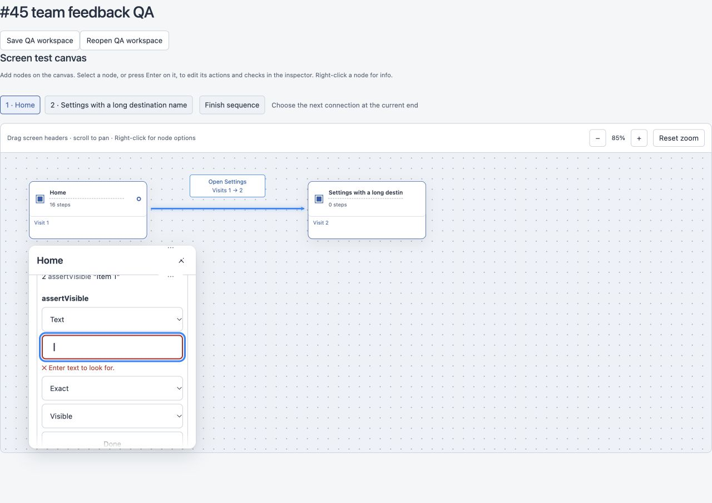

# Issue #45 team review follow-up

Follow-up to merged PR #63, based on Atlas, Shaka and Edison’s review in issue #45. The follow-up PR requires designated external team approval of its final revision, then Jerapong’s explicit merge confirmation. Local checks and subagent reviews cannot satisfy those gates.

## Behavior and review mapping

- Atlas: deleting steps and clearing destinations now apply immediately with one Undo; screen/connection deletion confirmation stays intact. Summary, overflow trigger/items, Move above actions and YAML controls are at least 44px high; the overflow trigger is 44px wide. YAML text computes to 13px. The navigation warning occurs only on the first affected step, wraps long destinations, and uses #8a4b00 on #fff4e5.
- Shaka: pure `stepRowLabel()` covers every supported command, quotes and optional destination. Mouse Cancel saves nothing. Last Move down is disabled; destination lookup is scoped to the source screen. Restored graph/source refresh an open draft, preventing stale blur saves. Screen-only legacy selector edits are documented.
- Edison and agreed selector spec: `isCommittableSelector()` rejects empty/whitespace values while preserving meaningful surrounding spaces exactly. Enter and blur show the specified accessible error and retain an invalid draft without refocusing. Typing clears the error. Escape restores an existing value or removes a new blank selector without replacing prior Undo history. ArrowUp moves backward and wraps; Enter/Done return focus to the summary.
- A newly added Back step becomes saved even when Done/Enter makes no source change; cancelling a later blank edit preserves it.

The selected visit’s neutral border and shortened top note remain from the original #45 handoff. Optional anchored Add step placement remains outside this focused follow-up. Reviewers should explicitly sign off the original golden driver’s unchanged-save assertion from #63; the current change only replaces cleanup confirmation clicks with assertions that no dialog appears.

## Validation

- Final full suite: 294/294 passing. Build/typecheck and canvas contract check pass. Build reports the existing bundle-size advisory (512 kB main bundle); no build failure. No server/shared/default-actions implementation changes; no golden fixture or snapshot drift.
- Two `GOLDEN_UPDATE=1 node --import tsx --test tests/golden-canvas.test.ts` runs: 18/18 each, committed snapshots unchanged.
- Focused floating inspector regressions: 22/22 passing. Pure helper tests cover every command with/without a destination and whitespace selector policy.
- Browser QA used the real CanvasEditor in an isolated local fixture, including the desktop viewport and long-list overflow. Verified blank Enter validation, 2px #b3261e field border, mouse Cancel/reopen, ArrowUp wrapping, new blank Escape, exact `" a "` save/reopen, immediate deletion/clear without a dialog, and single Undo restoration. QA serialization is a fixture harness; real workspace persistence is exercised by the existing UI journey suite.
- Computed hit targets: summaries ≥44px, overflow trigger 44×44px, overflow menu items 44px, Move above actions 44px, YAML 44px. Error text 12px. Contrast ratios: muted #596579 against white 5.90:1 and selected #e7f3ff 5.24:1; warning pair 6.26:1; error #b3261e against white 6.54:1.

## Mutation evidence

Each isolated mutation was applied to the current source, run against its named regression, and immediately restored. All 13 were rejected by assertion failures:

| Mutation | Detecting test |
| --- | --- |
| Remove label quotes | stepRowLabel formats every command |
| Remove destination suffix | stepRowLabel formats every command |
| Skip whitespace trim | selector validation rejects empty whitespace |
| ArrowUp moves forward | ArrowUp moves backwards and wraps |
| Remove mouse Cancel pointer guard | mouse Cancel and Escape followed by focusout |
| Remove Escape cancelled guard | mouse Cancel and Escape followed by focusout |
| Remove draft reset on reopen | mouse Cancel and Escape followed by focusout |
| Remove save summary focus | mouse Cancel and Escape followed by focusout |
| Remove invalid-selector save guard | empty selector Enter and blur |
| Remove blur save | inline rows commit Enter and blur |
| Skip new blank discard | Escape discards a new blank selector |
| Skip revision-triggered draft reset | an external Undo refreshes an open draft |
| Keep new-step marker after unchanged Back save | a saved new Back step remains saved |

The production source was restored before final validation. The initial red run exposed the missing selector guard and label behavior before implementation. Existing cleanup tests continue asserting exact graph/source Undo restoration; their confirmation expectations now reflect the agreed immediate behavior.
