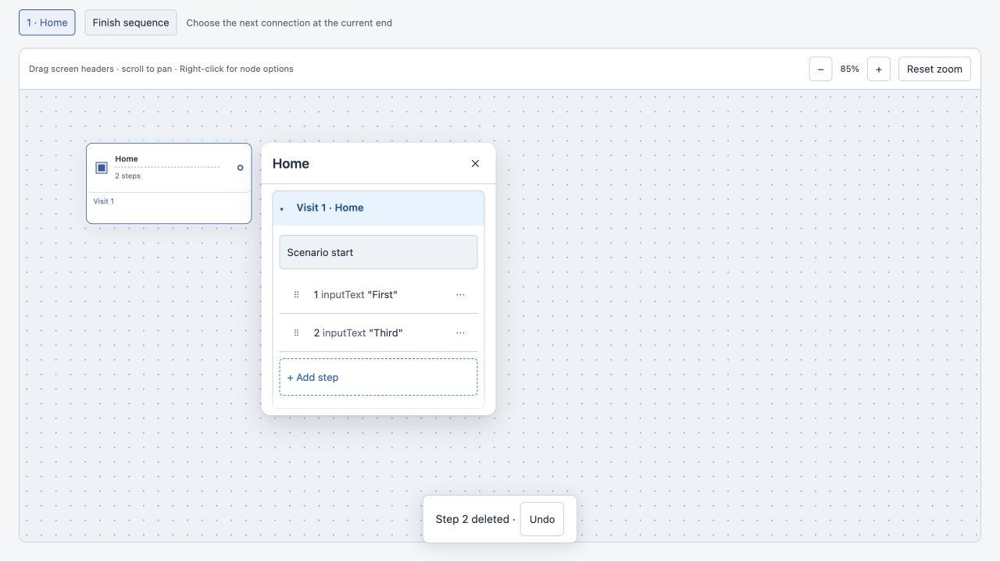

# Issue #46 verification

Original base: main `f3e96cd4b5f30bbe63470594922bad13b77b46b4`; integrated current main `d7c6ecbea3a850e28279545f391c78aec1ec746c` (PR #71 platform fix) after initial validation. Implementation: `4c8d19b279f8fea6a1ce7b1f45fef67282528128`, branch `codex/46-step-actions`. Dedicated chat: `01a1383c-4e18-7e13-ac3e-1453216bd268`.

The existing Step actions disclosure now has the requested accessible name. Menu moves retain focus and announce the new position. Drag handles apply successive adjacent swaps to a local visit order and commit one graph/YAML change. Deleting a saved visit step still uses the existing deletion planner immediately, now with a guarded, eight-second status toast. Undo restores the step and focus. A later graph/YAML edit invalidates and removes the Undo entry. Connection and screen deletion retain their existing confirmation dialogs.

## Evidence

- Red/green regressions: menu accessible name and focus; atomic reorder helper; drag handle/drop line/one Undo; delete toast/focus; drag-leave indicator cleanup. Added expiry, cross-visit drop rejection and drag cancellation coverage.
- `tests/floating-inspector-ui.test.ts` and `tests/inspector-operations.test.ts`: **37/37 pass**.
- Initial broader run of those files plus `tests/canvas-ui.test.ts` and `tests/golden-canvas.test.ts`: **63/63 pass** (before three additional expiry/cross-visit/drag-leave cases were added). Full suite includes all final cases.
- Initial full `npm test`: **316/318 pass**. Only failures: the two pre-existing Bash 3.2 zero-exception cases in `tests/check-canvas-contract.test.ts`, caused by `exception_patches[@]: unbound variable`. The script and its tests are unchanged from the pinned base. PR #71 merged during delivery; integrating main fixes these failures without changing #46 implementation. Final full `npm test`: **318/318 pass**, no failures.
- Typecheck and production build pass. Vite reports the existing >500 kB bundle warning.
- `npm run check:canvas-contract`: **pass (1 exception patch)**. No `shared/`, server or golden fixture changes.
- All **18 golden fixtures** match committed snapshots in the broader targeted run and both full-suite runs; no snapshot updates.
- Desktop browser at 1280×720, real CanvasEditor fixture: menu move retains focused step and announces; native pointer drag from position 2 to 4 reorders across multiple steps; one Undo restores pre-drag order; deletion commits immediately, focuses the next step and offers Undo; Undo restores the deleted step and focus; toast expires. Drag handles have 44px targets. Fixture and local server are temporary; no simulator/app execution was performed.

## Standards

Independent Codex reviewer approved implementation head `4c8d19b`: **0 documented-standard breaches**, **1 optional smell observation**. Menu moves and the drag helper both contain adjacent swap logic; sharing that implementation is an optional maintainability improvement, not a blocker. The menu continues to call the existing `moveOperation` as requested.

## Spec

Independent Codex reviewer: **PASS**, **0 actionable findings**, targeted tests **37/37**. A suspected focus issue when switching paths did not reproduce.

## Confirmed baseline clarification

Issue #46's destination-confirmation bullet is stale. Current main and `tests/golden-canvas-ui.ts` require immediate destination clearing with Undo. Cursor confirmed preserving that behavior for #46 in issue comments `6159549507` and `6159553957`; any change to that contract belongs to #47. No destination behavior was changed here.

## GitHub Codex follow-up: path-scoped deletion Undo

Review `5512448458`, comment `4266223090` (thread `PRRT_kwDOU7InGc6sJG5Z`) found a P2 missed by the earlier path-switch probe: two real paths can have identical graph/YAML state while the active `pathId` changes. The old guard still offered deletion Undo, but its restored visit was absent from the current path, losing focus.

A new mounted CanvasEditor regression uses two actual paths and a parent path selector. It failed on `935ee4a` with `another path must not offer Undo that cannot restore focus`. Implementation `f3a6c97d1cd46525b47342a752087867247da242` records the original `pathId` with step deletion Undo and includes it in the existing availability guard. Switching away hides and clears the entry without changing graph/YAML or moving focus; switching back cannot revive it. Connection/screen Undo behavior is unchanged.

After the fix: inspector/helper **38/38**, full suite **319/319**, typecheck, build and canvas contract pass. All 18 golden fixtures match without updates. Independent Codex Standards and Spec reviewers approve `f3a6c97` with no new findings. Earlier review approval did not cover this bug; the two-path regression now covers the reachable case.
