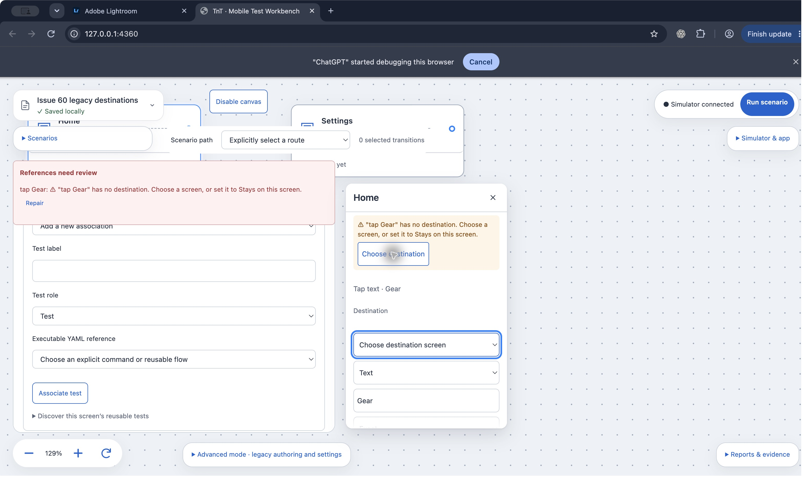

# Issue 60: legacy routes without destinations

Based on main `006024a` (includes #59, #45, #49 and #46). Original Cursor branch `cursor/legacy-missing-destination-de36` at `dbcaba1` is preserved; implementation lives on `codex/60-legacy-missing-destination` in its dedicated worktree.

## Behavior

The server emits exactly `{code: 'missing-destination', actionId}` for each unconnected action omitted from a legacy start-only route. Existing diagnostics retain their existing shape. Server execution rejects the route with a machine-readable `missing-destination:<id>` error before Maestro. The warning's wording and step-label lookup live in `src/canvas.tsx`.

Each affected row shows its own label and the agreed warning copy. Choose destination expands that row, focuses its Destination select and invokes its native picker. Selecting a screen or Stays on this screen removes the warning. Merged scenario visit draft/edit/reorder/Undo behavior remains intact.

One exception file, `50-legacy-missing-destination.patch`, records the protected server changes (`server/canvas.ts` and `server/canvas-route.ts`), without any shared changes or checker changes. The existing literal-Back exception is unchanged. The ordinary `server/scenarios.ts` change keeps package diagnostics machine-readable; it is outside the checker-protected file list.

## Validation

- `npm run typecheck`: pass.
- `npm test`: 340/340 pass on the rebased implementation.
- Focused warning/server tests: 11/11 pass, including two own labels, exact diagnostic shape, picker invocation while focused, both destination choices and pre-Maestro rejection.
- Mutation: remove the missing-destination emission in `inspectCanvas`; both actual CanvasEditor own-label warning tests fail (exit 1, expected two warnings versus none). Restore emission; focused tests pass.
- `GOLDEN_UPDATE=1 node --import tsx --test tests/golden-canvas.test.ts`: two runs, each 20/20 pass. No tracked golden diff after either run, and the two recorded golden diffs are identical.
- `npm run check:canvas-contract`: pass, 2 exception patches. Uses the current main checker; no duplication of #59/#70 work.
- `git diff --check`: pass.

The new golden recipe/snapshot intentionally records a legacy start-only route failing with `missing-destination:gear` before connecting Gear, then projecting after connection to Settings. No existing golden fixture or snapshot changes. Cursor's initial new snapshot contained warning wording; that one new snapshot now contains the machine error instead.

An earlier full run before rebase failed the known `Missing screen for tap-gear` golden race; it was posted to #55. Current merged main includes #55's fix, and the rebased full run passes.

## Browser evidence

Chrome on the isolated workbench at port 4360, with its own `.tnt` store:

1. Home contains two unconnected steps, `tap Gear` and `open Profile`; each warning uses its own label.
2. Click Gear's Choose destination: native accessibility state reports Action 1 destination, an open menu (Choose destination screen / Stays on this screen / Home / Settings), and the selected menu item as focused. The screenshot captures the blue focus ring.
3. Select Stays on this screen for Gear: only Profile's warning remains.
4. Click Profile's Choose destination: Action 2 destination's native menu opens. Select Settings: the remaining warning and reference alert disappear, and the Home-to-Settings connection appears.

**Capture limitation:** the native macOS menu is a separate overlay omitted by the available application/window screenshot API, although its open menu and focused item are exposed by accessibility. These are real screenshots, without a fabricated menu overlay. Independent Cursor design review should confirm the native menu visually and provide an overlay-inclusive capture if its environment supports it.

## Delivery gate

Draft PR targeting main. Independent Cursor review must name the final head, cover the rebase and the diagnostic/UI contract, and resolve all findings. Per the latest #60 task instruction, Codex must not self-merge; follow approved delivery with the team's merge owner and verify/report the actual result in the issue. A 30-minute heartbeat tracks review, feedback and delivery until verified completion.
