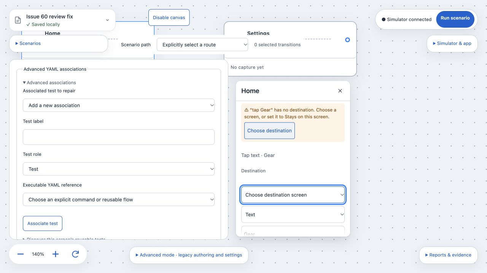
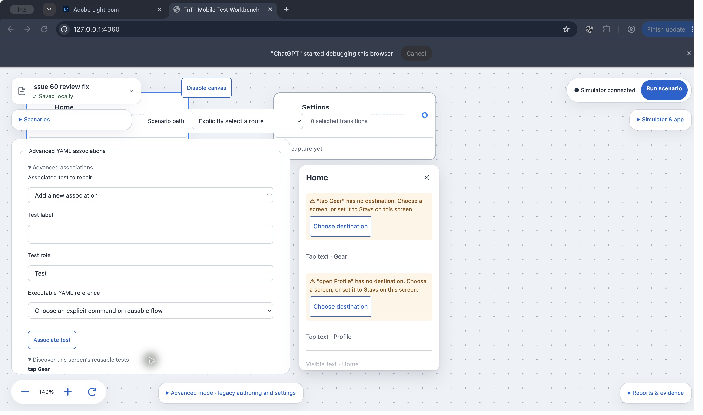

# Issue 60: legacy routes without destinations

Integrated main `e510ade` (#50 inspector run/failure/draft/autosave states), following `b362c0e` (#47 destination linking), `296b9fc` and the original rebase onto `006024a` (includes #59, #45, #49, #46 and the later picker/YAML draft fixes). Original Cursor branch `cursor/legacy-missing-destination-de36` at `dbcaba1` is preserved; implementation lives on `codex/60-legacy-missing-destination` in its dedicated worktree.

## Behavior

The server emits exactly `{code: 'missing-destination', actionId}` for each unconnected action omitted from a legacy start-only route. Existing diagnostics retain their existing shape. Server execution rejects the route with a machine-readable `missing-destination:<id>` error before Maestro. The warning's wording and step-label lookup live in `src/canvas.tsx`.

Missing-destination diagnostics are excluded from both the red reference alert and reusable-test reference errors. Genuine stale YAML references retain their red error and Repair action. Each affected row shows its own label and the agreed warning copy. Choose destination expands that row, focuses its Destination select and invokes its native picker. Selecting a screen or Stays on this screen removes the warning. Merged scenario visit draft/edit/reorder/Undo behavior remains intact.

One exception file, `50-legacy-missing-destination.patch`, records the protected server changes (`server/canvas.ts` and `server/canvas-route.ts`), without any shared changes or checker changes. The existing literal-Back exception is unchanged. The ordinary `server/scenarios.ts` change keeps package diagnostics machine-readable; it is outside the checker-protected file list.

## Validation

- `npm run typecheck`: pass.
- `npm test`: 376/376 pass on the integrated implementation. An initial run hit an `ENOTEMPTY` temporary-directory teardown race in #50’s run-state test; the isolated run and final full rerun pass.
- Focused warning/server tests: 17/17; with #47 destination-linking tests: 22/22 pass. Combined #47/#50/#60 check: 31/31; final warning/run UI check: 20/20, including two own labels, exact diagnostic shape, picker invocation while focused, both destination choices and pre-Maestro rejection.
- Mutation: remove the missing-destination emission in `inspectCanvas`; both actual CanvasEditor own-label warning tests fail (exit 1, expected two warnings versus none). Restore emission; focused tests pass.
- `GOLDEN_UPDATE=1 node --import tsx --test tests/golden-canvas.test.ts`: two runs, each 20/20 pass. No tracked golden diff after either run, and the two recorded golden diffs are identical.
- `npm run check:canvas-contract`: pass, 2 exception patches. Uses the current main checker; no duplication of #59/#70 work.
- `git diff --check`: pass.

The new golden recipe/snapshot intentionally records a legacy start-only route failing with `missing-destination:gear` before connecting Gear, then projecting after connection to Settings. No existing golden fixture or snapshot changes. Cursor's initial new snapshot contained warning wording; that one new snapshot now contains the machine error instead.

An earlier full run before rebase failed the known `Missing screen for tap-gear` golden race; it was posted to #55. Current merged main includes #55's fix, and the rebased full run passes.

## Browser evidence

Chrome (warning/discovery) and the in-app browser (focus ring) on the isolated workbench at port 4360, with its own `.tnt` store:

1. Home contains two unconnected steps, `tap Gear` and `open Profile`; each warning uses its own label.
2. Click Gear's Choose destination: native accessibility state reports Action 1 destination, an open menu (Choose destination screen / Stays on this screen / Home / Settings; #47 later adds + New screen…), and the selected menu item as focused. The screenshot captures the blue focus ring.
3. Select Stays on this screen for Gear: only Profile's warning remains.
4. Click Profile's Choose destination: Action 2 destination's native menu opens. Select Settings: the remaining warning and reference alert disappear, and the Home-to-Settings connection appears.

Review regression: adding an actual stale YAML association alongside the two missing destinations retains its red error and Repair button but adds neither missing destination to that alert. The same regression fails on the prior head with both warning sentences in the red banner. Browser inspection of the expanded reusable-test discovery confirms no duplicated warning there.

**Capture limitation:** the native macOS menu is a separate overlay omitted by the available application/window screenshot API, although its open menu and focused item are exposed by accessibility. These are real screenshots, without a fabricated menu overlay. Independent Cursor design review should confirm the native menu visually and provide an overlay-inclusive capture if its environment supports it.

## Main integration

Main advanced after Cursor approved `18f4817`, producing a content conflict at the VisitStep close and warning row. The ticket branch integrates main with a merge commit, preserving main's `picker`, `sourceYaml`, card-position props and the separate amber warning row. The feature diff relative to current main remains focused; server/shared exception content is unchanged. After that approval, main `b362c0e` introduced #47's destination component, New screen creation and clear-link confirmation. The second integration keeps those behaviors and adds an unresolved-only disabled placeholder to the private DestinationSelect component. Selecting Stays on this screen explicitly records legacy execution before the ordinary no-op guard; existing screen and New screen choices preserve frozen-start routing. New legacy/contextual cross-ticket regressions cover choosing Stays for one step, then creating/linking a new screen for the other, retaining both executable actions. The #47 linking, screen creation and clear-link-confirmation tests also pass. Main then advanced to `e510ade` (#50). The third integration preserves VisitStep run locking, status badges and draft-error props, drag/drop locking, and main’s run/failure/autosave implementation. Legacy warning controls are disabled/inert while running; labels, warnings and run badges remain readable. Two cross-ticket regressions verify that the warning remains visible while Choose destination cannot open the picker or change the graph during a run. Independent exact-head re-review is required for this integration.

## Delivery gate

PR targeting main, awaiting review of the integrated head. Independent Cursor review must name the final head, cover the rebase and the diagnostic/UI contract, and resolve all findings. Per the latest #60 task instruction, Codex must not self-merge; follow approved delivery with the team's merge owner and verify/report the actual result in the issue. A 30-minute heartbeat tracks review, feedback and delivery until verified completion.
