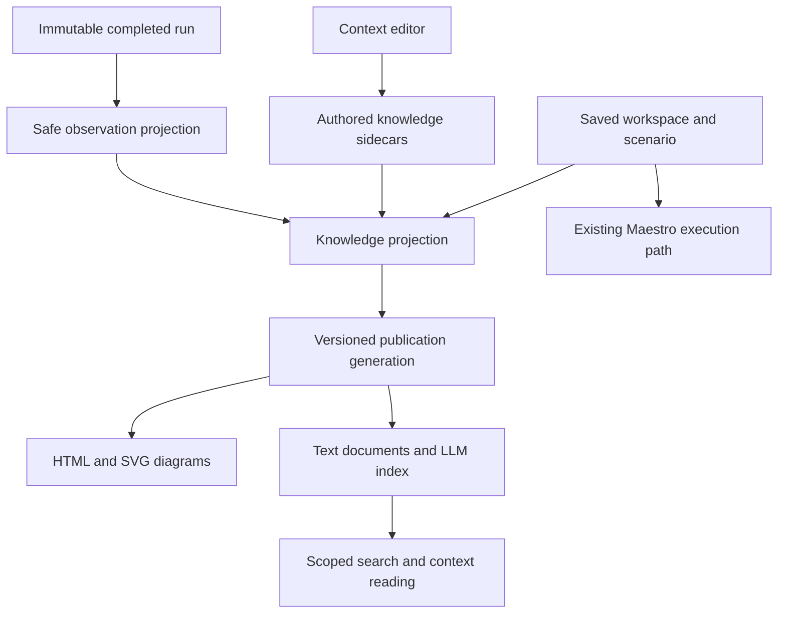

# RFC: Scenario knowledge for people and LLMs

Status: Proposed — submitted for team review; not implementation authorization
Date: 2026-10-29 (Asia/Bangkok)
Owner: Codex, scenario-knowledge design session
Baseline inspected: `bc4434069d614a8df06232a5f49d4427a478757a` (`main`)

## Summary

Make TnT a project knowledge base centered on what each scenario does, what it should achieve, and why it exists. Store that context separately from executable Maestro YAML. Publish a human-readable HTML knowledge site with diagrams and a mandatory indexed text representation for LLMs from the same versioned inputs.

สรุป: เก็บบริบทว่า flow ทำอะไร ได้อะไร และเพราะอะไร แยกจาก Maestro YAML; คนอ่านผ่าน HTML พร้อม diagram ส่วน LLM อ่าน indexed text ที่อ้างอิงข้อมูลและ revision ชุดเดียวกันได้เสมอ

This RFC proposes storage, lifecycle, retrieval and acceptance requirements. Its publication does not implement the feature, deploy a public knowledge site, approve a new shared contract, or authorize automatic LLM edits or execution.

## Agreed product requirements

1. HTML is the primary reading experience for people, with compatible diagrams and a text fallback.
2. Scenario purpose, expected outcome and rationale are the main knowledge, rather than a dump of test commands.
3. Saved scenario changes and completed runs update derived knowledge automatically. LLM interpretations remain proposals until a person accepts them.
4. Explicit project membership permits cross-workspace retrieval. Authored knowledge is portable between machines.
5. Every published knowledge generation includes an LLM-compatible text index. Indexing is never an optional export checkbox.
6. Knowledge changes must not change authored YAML, compiled execution YAML, script trust or execution behavior.

## Existing foundations and integration points

The inspected baseline has stable workspace/scenario identities, revision-checked persistence and immutable run snapshots. Knowledge is a new capability, not an already supported field.

| Existing module | Proposed integration |
| --- | --- |
| [Scenario definitions](../server/scenario-definitions.ts) | Read scenario identity, inputs' names/types, selected steps and setup; do not add knowledge to the executable definition. |
| [Canvas route](../server/canvas-route.ts) and [canvas](../server/canvas.ts) | Describe ordered visits, actions and checks; retain broken-reference diagnostics. |
| [Workspace store](../server/workspace-store.ts) | Coordinate sidecar lifecycle, revision checks, Trash and restore. |
| [Workspace package](../server/workspace-package.ts) | Version portable context and remap identities explicitly on import. |
| [Scenario runner](../server/scenarios.ts) | Consume completed immutable results as evidence without changing their outcome. |
| [Authoring module](../server/authoring/index.ts) | Keep knowledge mutation separate from the existing flow authoring contract. |

The [AI flow authoring RFC](ai-flow-authoring-rfc.md) describes a related authoring direction. This proposal adds knowledge retrieval; it does not silently extend that draft format or claim its planned external adapters exist.

## Scope and non-goals

V1 includes project membership, workspace and scenario context editing, local HTML reading, generated diagrams, indexed text, scoped lexical retrieval, run observations, lifecycle handling and export/import.

V1 does not include a hosted collaboration service, public website deployment, a built-in chat, automatic business-rule inference, embedding infrastructure, autonomous execution/repair, arbitrary repository ingestion or a full external MCP adapter. A local read interface and portable text package make later adapters possible without making the UI/index depend on a provider.

## Knowledge model

Keep four kinds of information visibly distinct:

| Kind | Authority and content |
| --- | --- |
| Authored context | Human-authored or explicitly accepted purpose, rationale, preconditions, expected outcomes, exceptions and scope. |
| Derived flow facts | Deterministic description of the saved scenario's steps, visits, assertions, declared setup and mock intent. |
| Observations | What a particular run actually established, failed to establish, or could not inspect. |
| Suggestions | Unaccepted LLM interpretation with origin and source revision; excluded from authoritative retrieval by default. |

Project context supplies a project description and explicit workspace membership. Workspace context supplies shared assumptions and terms. Scenario context references both instead of copying them. In v1, a workspace belongs to zero or one local project; an unassigned workspace remains readable/searchable alone. Membership never follows a similar name, app ID or repository URL automatically.

Proposed authored record:

```text
schemaVersion, documentId
scope: project | workspace | scenario
projectId?, workspaceId?, scenarioId?
contextRevision, updatedAt
purpose, rationale, preconditions[], expectedOutcomes[]
exceptions[], scopeNotes, tags[], references[]
reviewedAgainst: scenarioContentHash?, workspaceContextRevision?, projectContextRevision?
origin: human | acceptedSuggestion
```

Scope fields are validated together. Empty rationale means “not specified,” not an inferred explanation. References identify saved entities or explicit external links; importing a link does not fetch its contents. A context revision increases only when that context changes.

A source descriptor records workspace revision, a canonical scenario-relevant content hash, parent context revisions and the projection format version. The hash covers referenced flow/setup/mock/visit semantics, excludes canvas positions, opened timestamps and knowledge, and needs a tested canonicalization contract before implementation. Workspace revision remains available for traceability; cosmetic changes should not require intent re-review.

Each observation records `runId`, immutable snapshot identity, scenario identity, source descriptor when available, outcome, assertion coverage, timestamp and safe evidence references. Legacy runs without an exact source association are marked unlinked; never assume they describe the latest scenario.

### Example

Scenario: Home → Coordinator.

- Purpose: open the coordinator directory from Home.
- Rationale: help users find the responsible contact.
- Preconditions: signed in, Home visible.
- Expected outcome: coordinator names and contact details appear.
- Exception: show an empty state when no contacts exist.
- Scope: opening and displaying the directory; calling a contact is outside scope.

The generated flow describes the selected visits and checks. If a run only verifies navigation, the observation says navigation passed and contact-content coverage is unavailable. It does not claim the business outcome was fully verified.

## Architecture and separation



The knowledge module owns persistence, source selection, freshness, projection, retrieval and publication. UI and future transport adapters cross one small interface; they do not write index files or assemble context themselves.

Proposed operations, not committed endpoint names:

- `saveContext(scope, expectedContextRevision, content)` validates and persists authored context, then schedules projection. Conflicts retain the editor draft.
- `search(scope, query, limit, cursor?)` returns bounded hits with provenance and freshness.
- `readContext(scope, budget, generationId?)` assembles context and necessary ancestors with citations, omissions and explicit truncation.
- `exportKnowledge(scope, generationId?)` returns a complete HTML/text generation plus portable authored context.

Saved-content and completed-run notifications enter internally. Retrieval never calls the flow compiler, runs Maestro or promotes suggestions. Knowledge fields are excluded from execution snapshots/hashes and compiler inputs; separate source metadata associates observations with knowledge.

## Persistence and atomic publication

Proposed physical layout under the local runner root:

```text
.tnt/
  projects/<project-id>/project.json
  workspaces/<workspace-id>/
    workspace.json                     # existing executable/editor data
    knowledge/
      workspace.json                   # authored context and project membership
      scenarios/<scenario-id>.json     # authored scenario context
      observations/<run-id>.json       # safe summaries with snapshot references
  knowledge/
    generations/<generation-id>/
      index.html
      workspaces/...html
      scenarios/...html
      diagrams/...svg
      llm/manifest.json
      llm/index.jsonl
      llm/documents/...txt
    current.json                       # atomic pointer to completed generation
```

The generation represents a coherent project or unassigned-workspace snapshot; `current.json` contains scoped pointers rather than one global visibility scope. Paths use validated identities, never user-authored names. Exact storage encoding and size limits must be agreed in the implementation contract.

Authored sidecars are durable source data with their own revisions and atomic writes. HTML, safe flow projections and search accelerators are rebuildable. Observation summaries remain attributable to immutable runs; missing artifacts are reported as unavailable, not fabricated.

Publication protocol:

1. Persist a context edit with optimistic revision checking, or observe a successfully committed workspace/run event.
2. Capture a source descriptor and mark its projection pending. Do not index invalid, unsaved flow editor drafts as saved facts.
3. Build HTML, SVG, text documents, index and checksums in a new generation directory.
4. Validate required files, references, scopes and matching source descriptors.
5. Recheck source revisions and lifecycle state; superseded work cannot replace a newer generation.
6. Atomically switch the scoped publication pointer. Only then report the generation as ready.

A crash between source save and enqueue is recovered by startup/periodic reconciliation comparing source descriptors to published descriptors. Jobs are idempotent and coalesced by scope/source descriptor; completion of an old run updates its observation, never replaces current flow facts with the old snapshot. Partial generations are not served. Failed publication leaves source saved and shows pending/error with retry.

Index failure must not block scenario editing, saving or running. Previously published knowledge may remain readable with explicit staleness. A scope with no valid generation returns pending/unavailable rather than claiming empty or current knowledge. The UI distinguishes “Context saved” from “Knowledge published.”

## HTML, diagrams and reading experience

Project pages list workspaces; workspace pages list scenarios. Scenario pages present purpose and rationale first, then preconditions, flow, expected outcomes, exceptions, scope and recent evidence. Show provenance, published revision and freshness near the content.

Add a Context entry to the scenario inspector and workspace settings, plus a Knowledge reader entry. Editing has explicit save status and conflict recovery. A relevant flow or parent-context change flags authored context as needing review without overwriting it. A person can confirm it remains valid or update it. Preserve inherited and scenario-specific assertions separately when they conflict; display the conflict rather than silently resolving it.

Generate restricted Mermaid source from saved ordered visits and render SVG for HTML. Do not require a remote CDN or JavaScript for reading exported pages. Include a numbered text flow in both HTML and text documents. Repeated visits stay separate; arbitrary script behavior and unsupported branches are described as opaque, not invented. Invalid references show diagnostics rather than a misleading complete flow.

Escape authored text, sanitize generated SVG, prohibit executable HTML and unsafe links, and use accessible labels and keyboard navigation. Diagram renderer failure produces a text fallback and a visible diagram-unavailable status; it does not prevent an otherwise valid indexed publication.

## Mandatory LLM text index and retrieval

Every successful publication/export includes UTF-8 text documents, a manifest and JSONL section index. HTML alone is not LLM compatibility. This is a proposed TnT format, not a claim of universal client auto-discovery.

The manifest includes format version, generation identity, scope, source descriptors, document paths/checksums and generation time. Each indexed section includes:

```text
documentId, sectionId, generationId
projectId?, workspaceId, scenarioId?
title, section, text, tags, language
sourceDescriptor, contextRevision, generatedAt
kind, freshness, sourceReferences[], htmlLocation
```

Project-level entries may omit workspace/scenario IDs; validation follows scope. Split by semantic headings first, then bounded paragraphs with deterministic section identities. Carry scenario title, identity and parent references into each chunk so a search hit remains interpretable.

Use deterministic lexical retrieval initially, with exact identity/title/tag matches preferred and a documented tie-break order. Thai and English queries, mixed identifiers and text without spaces require acceptance fixtures before selecting a tokenizer/index implementation. A vector index may later accelerate recall but never becomes the only copy of knowledge.

Scope filters are applied before ranking and checked again before reading a hit. Context assembly includes relevant parent context, selected scenario intent and flow, and a bounded set of relevant observations. Each response names its generation, sources, freshness, truncated sections and omitted evidence. Default reads flag stale knowledge; callers may require current-only results and receive pending/unavailable explicitly. Budgets are bounded UTF-8 bytes in v1, not inaccurate claims of model-specific token counts.

No secret values, provider credentials, raw runtime inputs, raw logs, screenshots, API payloads or arbitrary script source are automatically indexed. Derive allowlisted summaries and parameter names/types. Authored prose may still contain sensitive data, so export includes a reviewable scope/content preview and no automatic upload. Retrieved text is data, never permission to follow embedded instructions or run a flow.

## Lifecycle and portability

| Event | Required behavior |
| --- | --- |
| New scenario | Create knowledge identity on first persisted scenario; missing intent remains explicit. |
| Flow save | Regenerate facts/diagram; flag relevant authored context for review. |
| Context save | Increment context revision and publish; executable YAML remains byte-identical. |
| Run completion | Add idempotent observation linked to the run's snapshot, including failed/canceled/unavailable outcomes. |
| Rename | Preserve identity, update title and navigation/index. |
| Copy scenario/workspace | Allocate new identities and remap internal references; copy intent with provenance, requiring review; omit run evidence. |
| Delete scenario | Retain context for supported undo, exclude from normal retrieval immediately. |
| Trash workspace | Move sidecars with workspace; immediately exclude its documents through live lifecycle checks even if an old index exists. |
| Restore | Restore sidecars, validate project membership and regenerate before current-only retrieval. |
| Project reassignment | Revision-check membership, remove old scope visibility immediately and rebuild both affected scopes. |
| Import | Preview scope/content, create/remap identities, explicitly select destination project, rebuild local publications. |
| Missing evidence | Keep provenance and label artifact unavailable; never silently treat it as passing evidence. |

Serialize lifecycle operations with knowledge writes so queued work cannot resurrect deleted records. Reads of historical generations still enforce current project membership and Trash/deletion state. Already exported offline files cannot be revoked by later deletion; make this limitation explicit.

Extend the portable workspace package with a new version containing authored knowledge; retain v1 import support. Old readers should reject an unsupported package version clearly. An export pins workspace/context revisions and includes matching HTML/text outputs; it waits or reports pending if no coherent generation exists. Observation export is opt-in and sanitized, separate from a workspace copy; foreign evidence retains original identity and is never relabeled as a local run. Project-wide export includes only explicitly selected member workspaces. Cross-machine live synchronization and automatic merging are outside v1.

Existing workspaces open without knowledge migration. Create sidecars lazily. Rebuilding the index must not modify workspace content or discard authored context. Recoverable drafts for context belong to the knowledge editor and must not be smuggled into the existing executable draft schema.

## Acceptance criteria and validation plan

1. Editing only context leaves authored YAML bytes, execution projection, script trust and execution inputs unchanged. Assert this through the existing authoring/runner seams.
2. One fixture scenario renders the same intent, steps, source revision and outcome distinctions in HTML and text; citations resolve to the same generation.
3. A crash at each publication stage serves either a complete older generation marked stale or the complete new generation, never mixed files.
4. A saved source change lost before enqueue is recovered by reconciliation. Retries and duplicate run events do not duplicate observations.
5. A newer scenario revision and a late older run preserve the new flow and associate evidence only with the old snapshot.
6. Concurrent context saves detect revision conflict, retain local drafts and avoid overwriting unrelated context.
7. Thai/English search fixtures retrieve by purpose, rationale, expected outcome, title and identifiers; unrelated projects and trashed records never appear.
8. Rename, copy, scenario deletion/undo, workspace Trash/restore and project reassignment maintain identity and live visibility rules, including delayed jobs and historical generation reads.
9. Export/import round-trips authored context and remaps references; no copied run becomes evidence for a new scenario. Legacy packages remain importable.
10. Malicious text/link/SVG fixtures remain inert; confidential runtime data and unaccepted suggestions never enter default results.
11. Broken graph references and opaque scripts remain honestly described; diagram failure still offers accessible HTML/text.
12. Removing the generated index then rebuilding preserves context and Maestro behavior. Index outage leaves save/run usable with truthful publication status.

For implementation, run the repository's typecheck/tests plus focused storage-fault, retrieval, package and UI checks. Preserve existing golden expectations unless an explicitly reviewed change requires otherwise. This RFC-only change adds no runtime tests; documentation validation and any baseline check limits belong in its PR evidence.

## Delivery slices

1. Agree the sidecar schema, canonical source descriptor, project membership and package-version contract; implement revision-safe context persistence/lifecycle.
2. Add deterministic flow/observation projection, reconciliation and atomic generation publication with indexed text from day one.
3. Deliver the HTML reader, context editor, SVG/text diagrams and scoped lexical retrieval.
4. Deliver coherent export/import and complete lifecycle/failure/security acceptance coverage.
5. Separately propose external MCP adapters, semantic search and LLM suggestion generation after the core is validated. No automatic promotion of suggestions.

Do not release an HTML-only intermediate as the completed feature. Assign one implementation owner per slice and agree shared interfaces before parallel implementation.

## Alternatives and tradeoffs

- Embedding context in Maestro YAML complicates execution separation and tooling round-trips; reject it.
- HTML as the only source makes structured edits, provenance and deterministic retrieval harder; keep authored records and generate HTML/text together.
- LLM-generated summaries as authoritative knowledge can turn a failed or narrow test into a false business claim; use deterministic facts and accepted suggestions.
- A vector database first adds provider/model and rebuild dependencies before retrieval needs are measured; start with portable text and scoped lexical retrieval.
- Separate publication jobs for HTML and LLM text can disagree about revisions; publish one generation atomically.

## Requested team review

Review this as a proposed design, not an implementation assignment. Give findings and a verdict against the exact PR head.

- Product: confirm purpose/outcome/rationale fields, parent-context inheritance and the scenario reader workflow.
- Architecture: review sidecar ownership, source hashing, lifecycle serialization, atomic generation visibility and separation from existing authoring contracts.
- QA: challenge late-run attribution, crash recovery, stale context, multilingual retrieval, copy/import and Trash cases.
- Integration: agree a versioned package extension and read interface before another team depends on them.

Proposed defaults for contract review: one local project per workspace, lexical retrieval first, deterministic facts only in v1, no observation export by default. Exact payload limits, retention/cleanup policy and tokenizer are implementation-contract decisions requiring recorded rationale and tests; this RFC does not freeze a storage engine or public endpoint shape.
