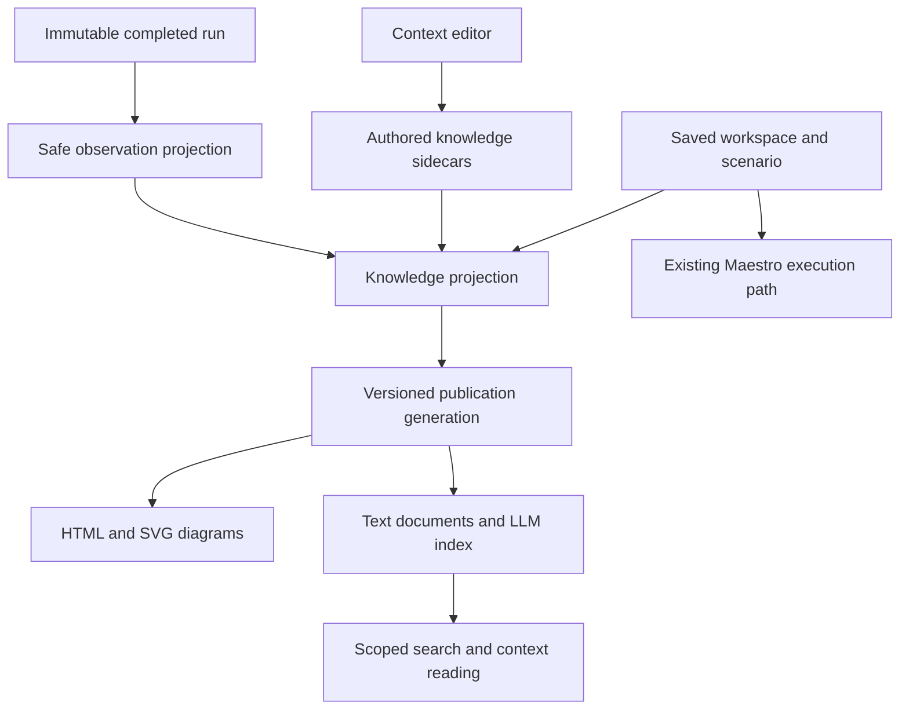

# RFC: Scenario knowledge for people and LLMs

Status: Proposed — submitted for team review; not implementation authorization
Date: 2026-10-29 (Asia/Bangkok)
Owner: Codex, scenario-knowledge design session
Baseline inspected: `bc4434069d614a8df06232a5f49d4427a478757a` (`main`)

## Summary

Make TnT a project knowledge base centered on what each scenario does, what it should achieve, and why it exists. Store that context separately from executable Maestro YAML. Publish a human-readable HTML knowledge site with diagrams and a mandatory indexed text representation for LLMs from the same versioned inputs.

สรุป: เก็บบริบทว่า flow ทำอะไร ได้อะไร และเพราะอะไร แยกจาก Maestro YAML; คนอ่านผ่าน HTML พร้อม diagram ส่วน LLM อ่าน indexed text ที่อ้างอิงข้อมูลและ revision ชุดเดียวกันได้เสมอ

This RFC proposes storage, lifecycle, retrieval and acceptance requirements. Its publication does not implement the feature, deploy a public knowledge site, approve a new shared contract, or authorize automatic LLM edits or execution.

## Agreed product requirements

1. People can read both in the canvas inspector and in a standalone HTML reader, from the same published data, with compatible diagrams and a text fallback. The user confirmed both surfaces after team review; HTML is not export-only.
2. Scenario purpose, expected outcome and rationale are the main knowledge, rather than a dump of test commands.
3. Saved scenario changes and completed runs update derived knowledge automatically. LLM interpretations remain proposals until a person accepts them.
4. Explicit project membership permits cross-workspace retrieval. Authored knowledge is portable between machines.
5. Every published knowledge generation includes an LLM-compatible text index. Indexing is never an optional export checkbox.
6. Knowledge changes must not change authored YAML, compiled execution YAML, script trust or execution behavior.

## Existing foundations and integration points

The inspected baseline has stable workspace/scenario identities, revision-checked persistence and immutable run snapshots. Knowledge is a new capability, not an already supported field.

| Existing module | Proposed integration |
| --- | --- |
| [Scenario definitions](../server/scenario-definitions.ts) | Read scenario identity, inputs' names/types, selected steps and setup; do not add knowledge to the executable definition. |
| [Canvas route](../server/canvas-route.ts) and [canvas](../server/canvas.ts) | Describe ordered visits, actions and checks; retain broken-reference diagnostics. |
| [Workspace store](../server/workspace-store.ts) | Coordinate sidecar lifecycle, revision checks, Trash and restore. |
| [Workspace package](../server/workspace-package.ts) | Version portable context and rebind it to the new workspace ID while preserving existing executable identity/trust rules. |
| [Scenario runner](../server/scenarios.ts) | Consume completed immutable results as evidence without changing their outcome. |
| [Authoring module](../server/authoring/index.ts) | Keep knowledge mutation separate from the existing flow authoring contract. |

The [AI flow authoring RFC](ai-flow-authoring-rfc.md) describes a related authoring direction. This proposal adds knowledge retrieval; it does not silently extend that draft format or claim its planned external adapters exist.

## Scope and non-goals

V1 includes project membership, workspace and scenario context editing, local HTML reading, generated diagrams, indexed text, scoped lexical retrieval, run observations, lifecycle handling and export/import.

V1 does not include a hosted collaboration service, public website deployment, a built-in chat, automatic business-rule inference, embedding infrastructure, autonomous execution/repair, arbitrary repository ingestion or a full external MCP adapter. A local read interface and portable text package make later adapters possible without making the UI/index depend on a provider.

## Knowledge model

Keep the following kinds distinct; v1 publications contain only the first three:

| Kind | Authority and content |
| --- | --- |
| Authored context | Human-authored or explicitly accepted purpose, rationale, preconditions, expected outcomes, exceptions and scope. |
| Derived flow facts | Deterministic description of the saved scenario's steps, visits, assertions, declared setup and mock intent. |
| Observations | Allowlisted run status and per-check results, without interpreting authored outcomes. |
| Suggestions (future slice) | Draft-only proposals; absent entirely from v1 publications, text documents and indexes. Explicit acceptance creates authored context. |

Project context supplies a project description. The workspace knowledge sidecar is the sole authority for project membership; a project member list is a rebuildable index. Project-authored context is durable separately from that index. Workspace context supplies shared assumptions and terms; scenario context references parents instead of copying them. A workspace belongs to zero or one local project. An unassigned workspace is isolated from every other unassigned workspace and every project. Membership never follows a similar name, app ID or repository URL automatically. Reconciliation trusts current workspace sidecars, never an outdated member list or historical generation.

Proposed authored record:

```text
schemaVersion, documentId
scope: project | workspace | scenario
projectId?, workspaceId?, scenarioId?
contextRevision, updatedAt
purpose, rationale, preconditions[], expectedOutcomes[]
exceptions[], scopeNotes, tags[], references[]
reviewedAgainst: scenarioContentHash?, workspaceContextRevision?, projectContextRevision?
origin: human | acceptedSuggestion
```

Scope fields are validated together. Empty rationale means “not specified,” not an inferred explanation. References identify saved entities or explicit external links; importing a link does not fetch its contents. A context revision increases only when that context changes.

A source descriptor records workspace revision, a canonical scenario-relevant content hash, parent context revisions and the projection format version. Reuse the saved authoring inputs used to prepare run snapshots, not the snapshot hash itself. The current snapshot hash also includes device, tool/runtime versions, reset/picker/runtime policy and the whole workspace; those are execution identity, not scenario intent. Keep existing snapshot bytes/hash unchanged. The knowledge hash uses selected scenario flow, referenced reusable flows, setup, mock configuration, ordered visits/checks, parameter declarations and script identity/content hashes. It excludes other scenarios, canvas positions, display titles, timestamps including `openedAt`, workspace revision counters, knowledge, device/tool versions and per-run inputs/policy. Script content affects the hash but is never published as text.

Canonical encoding mechanics are a slice 1 contract decision, but these inclusions/exclusions are fixed. Golden fixtures must prove step/check/setup/mock/script changes invalidate the hash, while node movement, opening and title renaming do not. Renaming still republishes navigation. Workspace revision is traceability, not the intent-review signal. Capture the knowledge source descriptor alongside the run via a separate association record before execution, without mutating the existing snapshot; a missing association stays unlinked.

Two independent freshness fields appear in index results, assembled context and reader details: `publicationFreshness: current | publication-stale` and `intentFreshness: reviewed | intent-needs-review`. A current publication does not clear the intent flag. Derive intent freshness from the reviewed-against descriptor and current relevant source/parent descriptors. Re-evaluate publication freshness against live source versions on reads; a static file's generation-time value cannot establish current freshness.

Observation content is a strict allowlist: `runId`, snapshot ID, status (`passed`, `failed`, `canceled`, `unavailable`) and per-check ID, safe authored label and recorded outcome. Scope/source association and timestamps are provenance metadata. Omit snapshot/execution YAML, logs, screenshots, mock bodies, runtime inputs and script source; never derive check labels from evaluated runtime text. Legacy runs without exact source association are unlinked.

Observations never mark a prose expected outcome verified, failed or uncovered. There is no v1 semantic mapping from free-text intent to checks. The deterministic statement “the saved flow has no check” describes the saved graph only. Every observation section and assembled response states that run/check results do not establish authored expected outcomes.

### Example

Scenario: Home → Coordinator.

- Purpose: open the coordinator directory from Home.
- Rationale: help users find the responsible contact.
- Preconditions: signed in, Home visible.
- Expected outcome: coordinator names and contact details appear.
- Exception: show an empty state when no contacts exist.
- Scope: opening and displaying the directory; calling a contact is outside scope.

The generated flow describes selected visits and checks. A navigation-only pass remains `kind: observation`, with its check ID/label/outcome. The adjacent expected contact-content outcome remains authored intent. The reader and assembled context state that run results do not establish authored outcomes; they do not infer contact-content coverage from the prose.

## Architecture and separation



The knowledge module owns source selection, freshness, projection, retrieval and publication, and requests sidecar persistence through the workspace store. UI and future transport adapters cross one small interface; they do not write index files or assemble context themselves.

Proposed operations, not committed endpoint names:

- `saveContext(scope, expectedContextRevision, content)` validates and persists authored context, then schedules projection. Conflicts retain the editor draft.
- `search(scope, query, limit, cursor?)` returns bounded hits with provenance and freshness.
- `readContext(scope, budget, generationId?)` assembles context and necessary ancestors with citations, omissions and explicit truncation.
- `exportKnowledge(scope, generationId?)` returns a complete HTML/text generation plus portable authored context.

Saved-content and completed-run notifications enter internally. Retrieval never calls the flow compiler, runs Maestro or promotes suggestions. Knowledge fields are excluded from execution snapshots/hashes and compiler inputs; separate source metadata associates observations with knowledge.

## Persistence and atomic publication

Proposed physical layout under the local runner root:

```text
.tnt/
  projects/<project-id>/context.json    # durable project-authored context
  projects/<project-id>/project.json    # rebuildable member index
  workspaces/<workspace-id>/
    workspace.json                     # existing executable/editor data
    knowledge/
      workspace.json                   # authored context and project membership
      scenarios/<scenario-id>.json     # authored scenario context
      observations/<run-id>.json       # safe summaries with snapshot references
  knowledge/
    generations/<scope-id>/<generation-id>/
      index.html
      workspaces/...html
      scenarios/...html
      diagrams/...svg
      llm/manifest.json
      llm/index.jsonl
      llm/documents/...txt
    current/<scope-id>.json             # one atomic pointer file per scope
```

Each generation represents exactly one project or one unassigned-workspace scope. Scope IDs include a type discriminator. Publishing replaces only `current/<scope-id>.json`, using an fsynced temporary file and atomic rename under a per-scope serialized compare/check-and-switch. It never rewrites another scope's pointer. Readers pin one generation for each request. Required publication files are the manifest, JSONL index, UTF-8 documents and HTML with numbered text flows. SVG is optional: failure publishes `diagram-unavailable` with text. A missing text index never becomes current. V1 generations omit suggestions entirely, rather than trusting readers to filter them.

Paths use validated identities, never authored names. Workspace-directory sidecar mutations use the workspace store's existing root-keyed serialization queue; this is an in-process queue, not a cross-process lock. All knowledge writers in the runner must go through that single owner, including observations, lifecycle checks and membership changes. A second knowledge process must call that owner, not write directories itself. Builds run outside the queue; only bounded source capture/commit steps use it. Check workspace existence, active state and saved scenario membership inside the queued commit, without create-on-missing behavior. Generation commits additionally recheck lifecycle under that owner before switching their scope pointer. Document the fixed lock/queue ordering in slice 1 to avoid deadlocks.

Authored sidecars are durable source data with their own revisions and atomic writes. HTML, safe flow projections and search accelerators are rebuildable. Observation summaries remain attributable to immutable runs; missing artifacts are reported as unavailable, not fabricated.

Publication protocol:

1. Persist a context edit with optimistic revision checking, or observe a successfully committed workspace/run event.
2. Capture a source descriptor and mark its projection pending. Do not index invalid, unsaved flow editor drafts as saved facts.
3. Build HTML, SVG, text documents, index and checksums in a new generation directory.
4. Validate the explicit required-file set above, references, scopes and matching source descriptors; SVG is optional.
5. Recheck source revisions and lifecycle state; superseded work cannot replace a newer generation.
6. Atomically replace only that scope's pointer while holding its publication serialization and the final lifecycle guard. Only then report the generation as ready.

A crash between source save and enqueue is recovered by startup/periodic reconciliation comparing source descriptors to published descriptors. Jobs are idempotent and coalesced by scope/source descriptor; completion of an old run updates its observation, never replaces current flow facts with the old snapshot. Partial generations are not served. Failed publication leaves source saved and shows pending/error with retry.

Slice 1–2 must expose injectable clock/queue and fault hooks at: (1) after source commit but before enqueue, (2) after descriptor capture before enqueue/build, (3) during each artifact write and before generation completion, (4) before/after required-file validation, (5) before/after the final revision/lifecycle check, and (6) before pointer rename and after rename before acknowledgment. Hooks must allow pause, failure and restart simulation. Test same-scope supersession, different-scope concurrency, purge races and recovery without sleeps as synchronization.

Index failure must not block scenario editing, saving or running. Previously published knowledge may remain readable with explicit staleness. A scope with no valid generation returns pending/unavailable rather than claiming empty or current knowledge. Reader details distinguish “Context saved” from “Knowledge published”; the compact status described below summarizes these states without hiding failures.

## HTML, diagrams and reading experience

People can read in the inspector beside the canvas and open the standalone HTML reader; HTML remains usable locally as well as for export/sharing. Both use the same publication generation. Editing lives in the inspector, with links between scenario context and canvas nodes; exported HTML has no editing dependency. Project pages list workspaces and workspace pages list scenarios.

Show Purpose and Expected outcome by default; place rationale, preconditions, flow, exceptions, scope and evidence in expandable sections, one expanded at a time. Keep rationale discoverable as “Why this flow exists.” One quiet summary reads “Up to date,” “Updating,” or “Needs review,” with details on activation. “Needs review” takes precedence for unresolved intent, save conflicts or publish errors; “Updating” means saved changes await publication; “Up to date” requires current publication and reviewed intent. Details distinguish each cause, provenance, both freshness fields, failed saves and retry. The editor must not label an unsaved edit saved or suppress actionable errors.

Add a Context entry to the scenario inspector and workspace settings, plus a Knowledge reader entry. Editing has explicit save status and conflict recovery. A relevant flow or parent-context change flags authored context as needing review without overwriting it. A person can confirm it remains valid or update it. Inherited versus scenario-specific conflicts mean authored workspace outcomes disagreeing with authored scenario outcomes; display both without silently resolving them. Shared canvas checks remain saved graph facts and are never merged into authored outcomes.

Generate restricted Mermaid source from saved ordered visits and render SVG for HTML. Do not require a remote CDN or JavaScript for reading exported pages. Include a numbered text flow in both HTML and text documents. Repeated visits stay separate; arbitrary script behavior and unsupported branches are described as opaque, not invented. Invalid references show diagnostics rather than a misleading complete flow.

Escape authored text, sanitize generated SVG, prohibit executable HTML and unsafe links, and use accessible labels and keyboard navigation. Diagram renderer failure produces a text fallback and a visible diagram-unavailable status; it does not prevent an otherwise valid indexed publication.

## Mandatory LLM text index and retrieval

Every successful publication/export includes UTF-8 text documents, a manifest and JSONL section index. HTML alone is not LLM compatibility. This is a proposed TnT format, not a claim of universal client auto-discovery.

The manifest includes format version, generation identity, scope, source descriptors, document paths/checksums and generation time. Each indexed section includes:

```text
documentId, sectionId, generationId
projectId?, workspaceId, scenarioId?
title, section, text, tags, language
sourceDescriptor, contextRevision, generatedAt
kind, publicationFreshness, intentFreshness, sourceReferences[], htmlLocation
```

Project-level entries may omit workspace/scenario IDs; validation follows scope. Split by semantic headings first, then bounded paragraphs with deterministic section identities. Carry scenario title, identity and parent references into each chunk so a search hit remains interpretable.

Use deterministic lexical retrieval, with exact identity/title/tag matches preferred and a stable document-ID tie-break. Proposed tokenizer: built-in `Intl.Segmenter('th', {granularity: 'word'})` for Thai/mixed text and word segmentation for English, keeping only word-like segments; additionally preserve whole identifiers as exact-match tokens. Normalize search text consistently (Unicode NFC and case folding for Latin), never alter stored source. Pin supported Node/ICU behavior with fixtures; startup must report unsupported segmentation instead of silently falling back to whitespace splitting. A vector index may later accelerate recall but never becomes the only copy of knowledge.

Proposed fixed retrieval gate: six synthetic documents and 24 queries (four per document), listed below. Each expected document must rank within the top 3 for every query; zero cross-scope or Trash hits. Put the target terms into the designated title, purpose, rationale, outcome and ID fields and commit full fixture texts before slice 3. Add competing documents with overlapping terms, not just six isolated exact matches. No semantic synonym recall is promised unless those terms are authored/indexed.

| Document / authored topic | Thai query | English query | Mixed query | Exact ID |
| --- | --- | --- | --- | --- |
| Coordinator directory | ค้นหาผู้ประสานงาน | coordinator directory | ติดต่อ Coordinator | scenario-coordinator |
| Successful login | เข้าสู่ระบบสำเร็จ | successful login | เข้าสู่ระบบ Login | scenario-login |
| Empty directory | ไม่มีข้อมูลผู้ติดต่อ | empty contacts | รายชื่อ Empty | scenario-empty |
| Maintenance notice | แจ้งปิดปรับปรุงระบบ | maintenance notice | แจ้งเตือน Maintenance | scenario-maintenance |
| Invalid password | รหัสผ่านไม่ถูกต้อง | invalid password | รหัสผ่าน Invalid | scenario-password |
| Return home | กลับหน้าหลัก | return home | กลับ Home | scenario-return |

Repeat the corpus in another project, two unassigned workspaces and Trash to test isolation. Also test a member versus a non-member, reassignment, project deletion, bidi names and mixed-case identifiers. Store expected rankings and tokenizer output as reviewed fixtures; the table is a proposed corpus, not a claim that the unimplemented search already passes.

Scope filters are applied before ranking and checked again before reading a hit. Context assembly includes relevant parent context, selected scenario intent and flow, and a bounded set of relevant observations. Each response names its generation, sources, freshness, truncated sections and omitted evidence. Default reads return both freshness fields; a current generation still surfaces `intent-needs-review`. Current-only constrains publication freshness, not intent approval, and returns pending/unavailable when necessary. Budgets are bounded UTF-8 bytes in v1, not inaccurate claims of model-specific token counts.

No secret values, provider credentials, raw runtime inputs, raw logs, screenshots, API payloads or arbitrary script source are automatically indexed. Derive allowlisted summaries and parameter names/types. Authored prose may still contain sensitive data, so export includes a reviewable scope/content preview and no automatic upload. Retrieved text is data, never permission to follow embedded instructions or run a flow.

## Lifecycle and portability

| Event | Required behavior |
| --- | --- |
| New scenario | Create knowledge identity on first persisted scenario; missing intent remains explicit. |
| Flow save | Regenerate facts/diagram; flag relevant authored context for review. |
| Context save | Increment context revision and publish; executable YAML remains byte-identical. |
| Run completion | Add idempotent observation linked to the run's snapshot, including failed/canceled/unavailable outcomes. |
| Rename | Preserve identity and intent hash; republish title/navigation without setting intent-needs-review. |
| Copy workspace | Existing copy allocates a new workspace ID only; preserve scenario/path/visit/script IDs. Rebind copied context to the new workspace, require intent review, omit observations and leave membership unassigned. Existing local/imported script-trust registration rules stay unchanged. |
| Duplicate scenario | Attach copied intent to the new scenario ID returned by existing `duplicateScenario`; it already allocates executable IDs and rebinds trust. Knowledge does not allocate another set. Require review and omit observations. |
| Scenario delete/undo | Saved `scenarios[]` is visibility authority. Unsaved editor delete/undo does not publish or create a tombstone. A committed omission excludes immediately; a later committed restoration of the same ID reattaches its retained sidecar. |
| Trash workspace | Move sidecars with workspace; immediately exclude its documents through live lifecycle checks even if an old index exists. |
| Restore | Restore sidecars, validate project membership and regenerate before current-only retrieval. |
| Project reassignment | Revision-check the authoritative sidecar, immediately remove old scope visibility and rebuild both scopes. Historical reads use current membership; current-only reads wait for matching generations. |
| Delete project | Immediately disable that project scope and unassign members without deleting their workspaces or context sidecars. Reconcile interrupted unassignments; a reference to a deleted project never grants visibility. |
| Purge workspace | Existing `purgeWorkspace` purges Trash; no new HTTP route is implied. Late knowledge/observation jobs no-op and cannot recreate `workspaces/<id>/` or retrieval entries. |
| Import | Allocate a new workspace ID only, preserve executable IDs, rebind knowledge and preserve existing imported-script trust policy. Explicitly choose a destination project or unassigned; rebuild publications. |
| Missing evidence | Keep provenance and label artifact unavailable; never silently treat it as passing evidence. |

Serialize lifecycle operations and knowledge writes through the workspace store owner so queued work cannot resurrect deleted records. Trash moves sidecars with the workspace directory; generations elsewhere remain subject to live visibility checks. Observation sidecars reference runs but never move/delete `.tnt/runs`; missing artifacts remain unavailable. Historical reads enforce current authoritative sidecar membership, project existence, active workspace state and saved scenario list. Already exported offline files cannot be revoked by later deletion; make this limitation explicit.

Extend `tnt-workspace` with a new version containing allowlisted authored context within the existing 1,100,000-byte limit, including formatted-export enforcement. Retain v1 import support; old readers clearly reject the new version. HTML, SVG and the LLM index are not embedded in workspace JSON. They form a separate knowledge export, which pins source/context revisions and waits or reports pending if a coherent generation is unavailable. Workspace-package export of authored context does not wait for the indexer.

Copy/import must preserve existing executable IDs and trust behavior, not transplant trust decisions: same-source local workspace copies may retain local origin under current rules; imported scripts remain imported under current registration rules. Knowledge must neither grant nor revoke script trust. Retain existing readable-name/bidi handling for names and source claims. Copies do not inherit membership, and imports require an explicit destination or unassigned choice. An observation export is separate and opt-in, retaining original run/snapshot IDs; it never contributes evidence to a copied/imported scenario. Project exports include only selected members. Live cross-machine sync is outside v1.

Existing workspaces open without knowledge migration. Create sidecars lazily. Rebuilding the index must not modify workspace content or discard authored context. Recoverable drafts for context belong to the knowledge editor and must not be smuggled into the existing executable draft schema.

## Acceptance criteria and validation plan

1. Editing only context leaves authored YAML bytes, execution projection, script trust and execution inputs unchanged. Assert this through the existing authoring/runner seams.
2. One fixture scenario renders the same intent, steps, source revision and outcome distinctions in HTML and text; citations resolve to the same generation.
3. A crash at each publication stage serves either a complete older generation marked stale or the complete new generation, never mixed files.
4. A saved source change lost before enqueue is recovered by reconciliation. Retries and duplicate run events do not duplicate observations.
5. A newer scenario revision and a late older run preserve the new flow and associate evidence only with the old snapshot.
6. Concurrent context saves detect revision conflict, retain local drafts and avoid overwriting unrelated context.
7. Thai/English search fixtures retrieve by purpose, rationale, expected outcome, title and identifiers; unrelated projects and trashed records never appear.
8. Rename, copy, scenario deletion/undo, workspace Trash/restore and project reassignment maintain identity and live visibility rules, including delayed jobs and historical generation reads.
9. Copy/import round-trips context, rebinds workspace identity and preserves executable IDs and existing trust policy; no observations or implicit project membership transfer. Scenario duplication uses IDs already returned by the existing operation. Legacy packages remain importable.
10. Malicious text/link/SVG fixtures remain inert; confidential runtime data and all unaccepted suggestions are absent from v1 publications, not merely filtered at read time.
11. Broken graph references and opaque scripts remain honestly described; diagram failure still offers accessible HTML/text.
12. Removing the generated index then rebuilding preserves context and Maestro behavior. Index outage leaves save/run usable with truthful publication status.
13. Existing workspaces without knowledge pass the current regression suite; execution golden snapshots, authoring contract SHA and controlled run snapshot bytes/hash remain unchanged. Validate context save, copy, import, Trash, restore and runs against their pre-knowledge behavior, not only context edits. Existing baseline failures must be diagnosed or explicitly dispositioned before implementation release; this RFC's earlier 701/707 run is not a green gate.
14. Save and run start never await indexing. With an injectable blocked/failing queue, prove both complete without releasing that queue. On a fixed benchmark machine/corpus, compare idle, indexing and failed-indexer p95 latency; proposed budget is at most 5% or 20 ms added latency (whichever is larger), subject to explicit team agreement before implementation. Keep expensive projection off the runner event loop/critical queue.
15. Compatibility fixtures cover v1 package → new reader, new package → clear old-reader rejection, old workspace with existing runs, both copy/import bidi-name rules, and package-size boundaries. Generated HTML/index never appears in the workspace JSON.
16. Two concurrent scope publications both remain current. Pointer faults leave each scope at its previous complete or newly committed complete generation, never erase another scope. Test every listed fault hook and reconciliation after restart.
17. Unassigned A is invisible to unassigned B and every project; members cannot retrieve non-members. Sidecar/index disagreement, reassignment and project deletion use current authority for all historical reads, including before rebuild.
18. After purge, a delayed observation/publication leaves no workspace directory or hit. Committed scenario delete/restoration controls visibility even with a delayed job; editor-only undo does not mutate server visibility. Run directories stay unchanged.
19. A navigation-only pass beside a contact-content expected outcome remains an observation, with the explicit non-establishment notice and no prose coverage judgment. A current generation can simultaneously report intent-needs-review. Parent/scenario outcome conflicts remain authored text separate from shared checks.
20. The 24-query corpus returns every expected document in the top 3 with zero cross-scope/Trash hits, including Thai without spaces. Golden source-hash tests cover both invalidating and non-invalidating changes. Repeated retries of one Apply/Restore never stack review notifications.

For implementation, run the repository's typecheck/tests plus focused storage-fault, retrieval, package and UI checks. Preserve existing golden expectations unless an explicitly reviewed change requires otherwise. This RFC-only change adds no runtime tests; documentation validation and any baseline check limits belong in its PR evidence.

## AI authoring interaction

Define a review round as one successfully committed Apply or Restore operation, identified by its durable operation/revision identity, not an entire editor session. Failed/canceled previews create no round. Coalesce internal writes and retries into one invalidation per operation; maintain one outstanding intent-review state rather than stacking banners. Manual saves use the relevant content hash and the same outstanding state. Restoring the exact reviewed-against content can clear a source-change flag if parent context also still matches.

Counter-proposal to the team's prompt suggestion: keep v1 free of suggestion records; in future slice 5, show the generation prompt as a draft-only suggested Purpose before Apply. An explicit separate acceptance can save it as authored context after successful Apply; Apply alone never accepts it. Reject/cancel does not persist it, and unaccepted prompt text never enters publication/index. This preserves the v1 no-suggestions rule while recording the requested future interaction.

## Delivery slices

1. Agree sidecar/hash/publication contracts and deliver one visible vertical slice: one workspace's scenario context, simple inspector and standalone HTML reading, mandatory indexed text, atomic publication and failure hooks. Keep current and previous complete generations; pin active reads/exports before cleanup. No HTML-only release.
2. Add explicit projects, parent contexts, scoped retrieval, lifecycle and reconciliation, using the same single-writer rules. Complete the fixed query fixtures before retrieval release.
3. Add allowlisted run observations and the fuller diagram/reader workflow; preserve non-establishment of prose outcomes.
4. Add versioned workspace context portability and separate HTML/index exports; finish the compatibility and lifecycle gates.
5. Separately propose MCP adapters, semantic search and draft-only AI Purpose suggestions. No automatic promotion.

The complete v1 requires slices 1–4; a one-workspace pilot is explicitly narrower. Match diagrams to canvas terminology/appearance where practical and provide “Open on canvas” links in local reading; offline exports show a safe unavailable hint when no matching local workspace exists. Proposed initial budget on a fixed fixture of 100 scenarios / 1 MiB authored text: publish p95 within 2 seconds and combined generated text/index within 10 MiB, excluding optional SVG. These are review targets, not measured performance claims; agree the benchmark environment and enforce limits in the implementation contract. Assign one owner per slice and agree shared interfaces before parallel implementation.

## Alternatives and tradeoffs

- Embedding context in Maestro YAML complicates execution separation and tooling round-trips; reject it.
- HTML as the only source makes structured edits, provenance and deterministic retrieval harder; keep authored records and generate HTML/text together.
- LLM-generated summaries as authoritative knowledge can turn a failed or narrow test into a false business claim; use deterministic facts and accepted suggestions.
- A vector database first adds provider/model and rebuild dependencies before retrieval needs are measured; start with portable text and scoped lexical retrieval.
- Separate publication jobs for HTML and LLM text can disagree about revisions; publish one generation atomically.

## Requested team review

Review this as a proposed design, not an implementation assignment. Give findings and a verdict against the exact PR head.

- Product: confirm purpose/outcome/rationale fields, parent-context inheritance and the scenario reader workflow.
- Architecture: review sidecar ownership, source hashing, lifecycle serialization, atomic generation visibility and separation from existing authoring contracts.
- QA: challenge late-run attribution, crash recovery, stale context, multilingual retrieval, copy/import and Trash cases.
- Integration: agree a versioned package extension and read interface before another team depends on them.

Proposed defaults for contract review: one local project per workspace, lexical retrieval first, deterministic facts only in v1, no observation export by default. The proposed tokenizer, fixed query corpus, performance budgets and generation-retention policy above require explicit team agreement and fixtures before implementation; exact payload limits remain contract decisions. This RFC does not freeze a storage engine or public endpoint shape.
